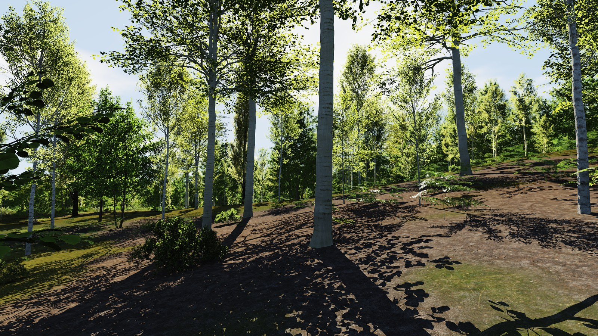
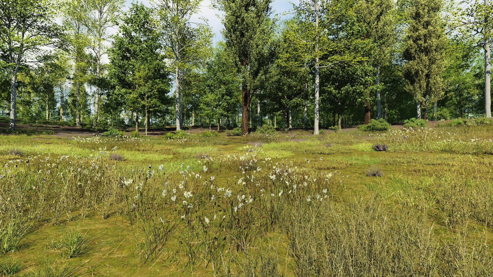
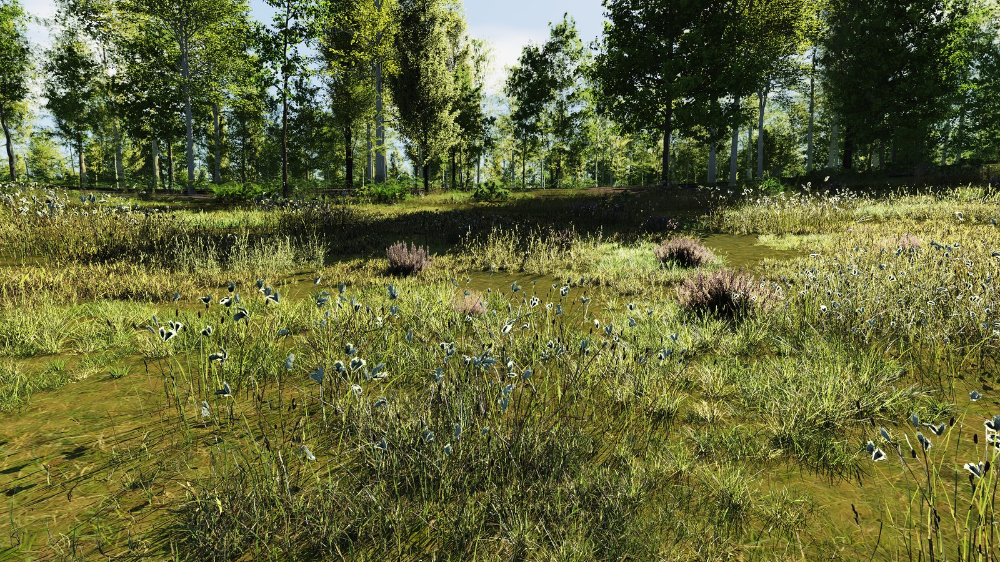
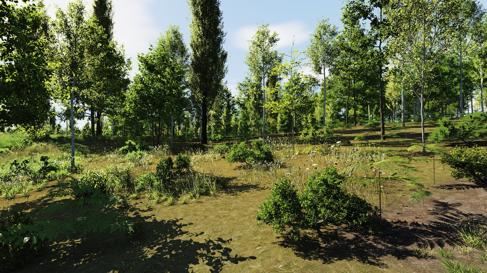
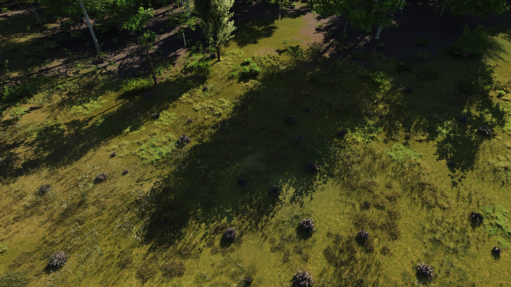
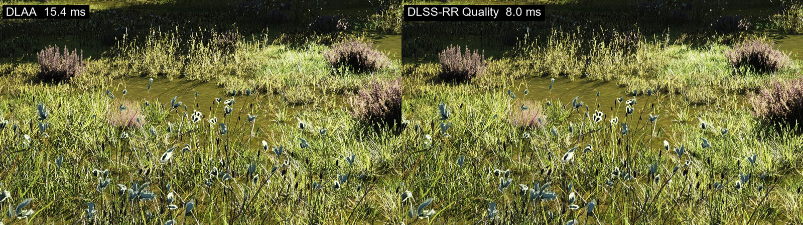
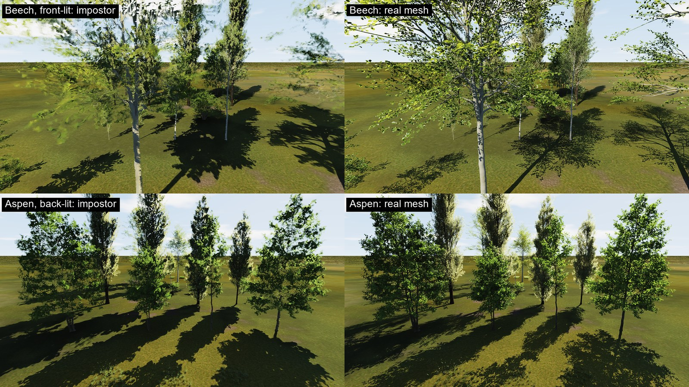
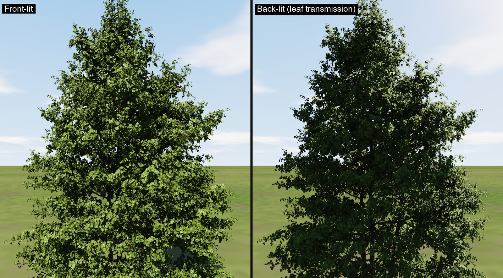

# SmartImposter

**A hardware ray-traced forest renderer, written from scratch in Rust + Vulkan. Every plant beyond
its mesh distance is a parallax octahedral impostor evaluated by the RTX cores, and NVIDIA DLSS Ray
Reconstruction turns one noisy sample per pixel into the final image.**


The world holds **440,899 plants of 14 species**:

| Layer | Count | Species |
|---|---|---|
| Canopy trees | 103,052 | European beech, black alder, black poplar, European aspen, common hazel |
| Shrubs | 56,512 | heather, huckleberry oak |
| Ferns | 182,752 | bracken |
| Grass patches | 98,583 | wild grass, grass clumps, tall grass, tufted grass, dry grass, cotton grass |

Trees, shrubs and ferns are **Quixel Megaplants**, with every leaf as real geometry: up to
**519 million triangles per tree** once all twig instances are expanded. The grass is **Quixel
Megascans** alpha-tested cards. Near the camera everything is drawn as the real asset. Beyond that,
each plant collapses to a single AABB in the acceleration structure, and an intersection shader
ray-marches a baked, BC-compressed hemi-octahedral atlas of it. The bake runs on the same GPU, with
the same ray tracing pipeline, in about 2 seconds at startup.

**At 1440p on an RTX 5080: 8.0 ms per frame with DLSS-RR Quality, 15.4 ms with DLAA.**

|  |  |
|---|---|
| Beech, aspen and alder over leaf litter, with bracken and huckleberry in the understory | From 55 m up. Every tree past ~50 m is an impostor |
|  |  |
| Cotton grass on wet ground, dry grass and heather | Real Megascans grass cards at eye level |
|  |  |
| Forest edge: poplar, hazel and huckleberry | Looking down on a meadow: real grass near, grass impostors far |

## Contents

- [Highlights](#highlights)
- [Performance](#performance)
- [How it works](#how-it-works)
  1. [Assets](#1-assets-keeping-half-a-billion-triangles-cheap)
  2. [Baking and compressing the impostor](#2-baking-and-compressing-the-impostor)
  3. [The intersection shader](#3-the-intersection-shader-shadersimpostorrint)
  4. [Lighting impostors like the real plant](#4-lighting-impostors-like-the-real-plant)
  5. [Grass](#5-grass)
  6. [LOD and draw distance](#6-lod-and-draw-distance)
  7. [Forest layout and ground](#7-forest-layout-and-ground)
  8. [Materials](#8-materials)
  9. [Frame: DLSS Ray Reconstruction](#9-frame-dlss-ray-reconstruction-or-taa)
  10. [Performance work](#10-performance-work)
- [Getting started](#getting-started)
- [Tools](#tools) · [Code layout](#code-layout) · [Limitations](#limitations) · [License](#license)

## Highlights

- **Hardware ray tracing end to end.** Primary rays, sun shadows, AO and the impostor bake all go
  through `VK_KHR_ray_tracing_pipeline`. There's no rasterizer.
- **Impostors as procedural geometry.** One AABB per far plant. The RT cores do traversal and
  culling, and a custom intersection shader marches the baked depth (parallax occlusion mapping in
  each view's orthographic space).
- **DLSS Ray Reconstruction.** NVIDIA's AI denoiser and upscaler replaces TAA + supersampling,
  through a small C++ shim over the NGX SDK. Without the SDK the engine builds and runs with its
  own TAA.
- **Shader Execution Reordering.** On RTX 40/50 the primary rays are regrouped by what they hit
  before shading.
- **A mixed forest from data.** Every species pack in `assets/species` is loaded. Four scattered
  layers (canopy, shrubs, ferns, grass) follow biome fields: beech stands, alder on wet ground,
  poplar and hazel at forest edges, aspen groves, heather on dry open ground, bracken under the
  canopy, cotton grass in wet meadows.
- **Megascans grass.** Clumps are grouped into 3 m patches. Real alpha-tested cards near the
  camera, compressed impostors beyond, the ground texture past the draw distance.
- **Compressed, size-aware atlases.** Each variant's atlas is sized to the plant and BC-compressed
  on the GPU right after the bake: 52 variants in 2.05 GB instead of 10.1 GB.
- **Impostors that light like the real plant.** Traced, layered self-shadowing, plus the *normal
  spread* of the leaves or blades baked per texel. Impostor brightness is within a few percent of
  the real meshes, front-lit, back-lit and from above, for trees and grass alike.
- **Natural ground.** Four scanned surfaces with hex-tile stochastic texturing (no visible
  repetition), blended by a mask built from the actual tree crowns, moisture and dryness.
- **LOD with no popping.** Every boundary is a stochastic per-pixel dissolve. The mesh any-hit and
  the impostor intersection shader share one random number, so exactly one copy of a plant answers
  each ray.

## Performance

RTX 5080, 2560x1440, camera moving or freshly placed every frame. DLAA is the quality reference.

| Scene | DLAA | DLSS-RR Quality | DLSS-RR Balanced |
|---|---|---|---|
| Meadow at eye level (hero image) | 15.4 ms | 8.0 ms | 6.5 ms |
| Meadow from 15 m, looking down | 16.5 ms | 8.7 ms | 7.2 ms |
| Forest interior | 11.3 ms | 6.1 ms | 5.3 ms |
| 1.8 km fly-through (median) | 11.0 ms | | |

Quality renders at 1708x960 and is about 2x faster than DLAA. It's a little softer on grass blades:



Where the time goes, DLAA meadow view (GPU timestamps, printed by every screenshot run):

| Pass | Time |
|---|---|
| Ray tracing: primary rays and shading | 5.5 ms |
| Ray tracing: sun shadow rays | 1.9 ms |
| Ray tracing: ambient occlusion rays | 1.5 ms |
| DLSS Ray Reconstruction (DLAA, 1440p) | 5.1 ms |
| TLAS rebuild, tonemap, sharpen, blit | 0.2 ms |
| CPU: LOD for 440k plants and instance list (overlapped with the GPU) | ~1 ms |

Startup (texture decode, BLAS build, bake and compression of 52 atlases) takes about 5.3 s. GPU
memory: impostor atlases 2.05 GB, plant textures 0.85 GB, ground textures 0.27 GB.

## How it works

```mermaid
flowchart LR
    UE["Unreal project<br/>(Fab Megaplants)"] -->|tools/ue_export_megaplants.py| USD["per-species USD meshes,<br/>assembly.json, textures"]
    USD -->|tools/megaplant_to_mtree.py| MTREE["assets/species/*.mtree + .json"]
    FAB["Fab Megascans grass<br/>(glTF)"] -->|tools/grass_to_mtree.py| MTREE
    MTREE --> CAT["catalog.rs<br/>species, variants, LOD scale"]
    CAT --> WORLD["world.rs<br/>biome scatter, ground mask"]
    CAT --> BLAS["BLAS per unique mesh<br/>AABB BLAS per variant"]
    BLAS --> BAKE["Impostor bake<br/>(bake.rgen, alpha-tested)"]
    BAKE --> ENC["mip.comp + bcenc.comp<br/>BC3 / BC5 atlases"]
    WORLD --> FRAME["Per frame (CPU, overlapped):<br/>LOD per plant, instance list"]
    ENC --> FRAME
    FRAME --> TRACE["main.rgen (SER)<br/>primary + shadow + AO rays,<br/>G-buffer"]
    TRACE --> DLSS["DLSS Ray Reconstruction<br/>(or taa.comp)"] --> RES["resolve.comp<br/>tonemap"] --> CAS["sharpen.comp"] --> OUT["swapchain"]
```



### 1. Assets: keeping half a billion triangles cheap

In UE 5.x a Megaplant is a Nanite assembly: a hierarchy of parts (trunk, branches, twigs, leaf
clusters) placed by transforms, with the same few meshes reused hundreds to thousands of times.
`ue_export_megaplants.py` reads that assembly data inside Unreal and exports each unique mesh, the
part hierarchy, the textures and the material parameters. `megaplant_to_mtree.py` flattens the
hierarchy: small subtrees are merged into one mesh, large ones stay instanced. The result is unique
meshes plus a list of (mesh, transform) parts per variant.

The engine builds one BLAS per unique mesh: 162 meshes, 9.2M triangles, for 52 variants. A
near tree costs one TLAS instance per part, not a copy of its geometry:

| Species | Expanded triangles per variant | Parts per variant |
|---|---|---|
| Black alder | 71M – 519M | 281 – 2,029 |
| Black poplar | 59M – 119M | 1,251 – 2,459 |
| European beech | 1.2M – 27M | 105 – 388 |
| European aspen | 2.1M – 12M | 131 – 795 |
| Heather | 3.0M – 15M | 113 – 668 |
| Grass patch | 0.1M – 1.4M | 10 – 194 clumps |

### 2. Baking and compressing the impostor

`bake.rgen` builds a TLAS containing just one full-detail plant and shoots orthographic rays from
12x12 directions on a hemi-octahedral grid, with 3x3 sub-samples per texel. It's the same ray
tracing pipeline and the same closest-hit and any-hit shaders used at runtime, so the bake sees
exactly the materials, and the alpha-tested cut-outs, the meshes have.


Each variant's frame resolution follows its size: 5.5 cm texels for a full-size tree (scaled by
the variant's LOD scale, since small plants switch to impostors closer; grass gets 1.6x coarser
texels), rounded to a multiple of 32 and capped at 448 px.

The bake writes an uncompressed scratch atlas shared by all variants. `mip.comp` builds
coverage-weighted mips, so empty texels don't drag depth or colour towards zero. Then `bcenc.comp`
(one thread per 4x4 block) compresses every level, and the blocks are copied into the sampled
atlases:

| Atlas | Format | Contents |
|---|---|---|
| albedo | BC3 | sqrt(albedo), ray-traced ambient occlusion |
| normal | BC5 | octahedral normal |
| depth | BC5 | depth along the view, coverage (fraction of sub-samples that hit) |
| visibility | BC3, half resolution | sky visibility `a + b·up`, **normal spread** (length of the averaged normal) |

Texels with zero coverage are left out of the block endpoint fit, so silhouette blocks keep their
precision. That's 3.25 bytes per texel instead of 16. All 52 variants take 2.05 GB (6–125 MB each).

### 3. The intersection shader (`shaders/impostor.rint`)

For each far plant a ray touches, the RT cores invoke the intersection shader with the ray in
plant space:

1. **LOD decision.** The shader looks up the instance (per-instance buffer indexed by
   `gl_InstanceID`). It dissolves against the mesh copy if the plant is in the mesh band, and
   dissolves the plant out near its draw distance.
2. **View selection.** It finds the 3 baked views around the ray direction and picks **one**,
   with probability equal to its (sharpened) barycentric weight. Blending three slightly
   misaligned views per sample causes ghosting and a smeared look. The temporal accumulation
   (DLSS-RR or TAA) averages the stochastic choice instead.
3. **Parallax march.** In that view's orthographic space the ray is linear, `S(t) = A + B·t`
   (uv, height), and is marched against the baked depth:
   - **Front crossings only:** a hit requires an empty → solid transition, so rays entering the
     box from the side don't hit extruded heightfield walls.
   - **Foliage shell:** a thin shell behind the surface (0.12 of the radius), not an infinitely
     deep solid, so views from below don't smear on clump undersides.
   - **Coverage decided once per crossing:** a ray is blocked with probability equal to the
     texel's coverage. Testing at every step biases towards the maximum along the path, which
     made crowns too dense and shadows solid.
   - **Adaptive step count, binary refinement, single-mip march fetches.**
4. **Attributes.** It reports the hit with albedo, normal and visibility packed into hit
   attributes.

### 4. Lighting impostors like the real plant

**Shadows.** Shadow rays through an impostor are marched like a camera ray **from the sun**:
stochastic view choice around the light direction, shell crossing, then a fresh coverage test
every 0.12 of the radius of crown depth (layered, Beer–Lambert-like). The light that reaches a
leaf or the ground under a crown is dappled, like the real one.

**Normal spread.** An impostor texel stands for many leaves or blades facing different ways. The
bake averages their normals; the *length* of that average says how coherent they are (1 = a flat
surface, ~0.5 = leaves in all directions), and that's stored per texel and per mip. Using the
renormalised average as if it were one surface lit every texel as if all its leaves faced the sun:
grass seen from above came out 1.6–2x too bright, and trees needed a fudge factor.

- **Trees** return their normal shortened to the spread, so Lambert gives the leaves' mean
  diffuse. Leaf transmission keeps full strength: some leaves always face away from the sun.
- **Grass and ferns** have normals bent upwards, so seen from above hardly any blade is back-lit:
  the spread scales all their sunlight.

**Crown-level transmission and sheen.** With the crown normal, `max(-n·l)` put a whole crown's
transmission on the side facing away from the sun at full strength, and the tonemapper bleached
those hot spots. Impostors use a broad lobe with the same total energy. Glossy leaves get a Fresnel
sheen of the view/sun geometry: in a crown some leaf always faces the half vector.

Measured on plant pixels only, impostor / real mesh brightness:

| Plant | Front-lit | Back-lit | From above |
|---|---|---|---|
| Alder | 1.02 | 0.98 | 0.87* |
| Aspen | 1.05 | 1.00 | 0.87* |
| Beech | 1.02 | 0.98 | 0.95* |
| Poplar | 1.20 | 0.98 | 0.82* |
| Wild grass | 0.98 (low angle) | | 0.99 |
| Dry grass | 0.99 (low angle) | | 1.14 |

\* From above, the impostor's albedo itself reads 0.86–0.90 (crown edges), so the lighting is
within a few percent.



### 5. Grass

A Megascans grass asset is a few small clumps (0.3–1.3 m), far too small to instance one by one
across a landscape. `tools/grass_to_mtree.py` reads the Fab glTF download and builds **patch**
variants: about 3 m of randomly placed, rotated and scaled clumps (instanced parts of the LOD0
meshes) inside a disc with a ragged edge, so overlapping patches merge into one sward. It also
composes the engine's foliage texture pair (colour+opacity, normal+translucency) and reads the
material's translucency tint.

- **Alpha testing:** meshes of grass species are flagged; their instances are non-opaque, and
  `tri.rahit` discards hits where the texture's opacity is below the cutoff. The cutoff drops with
  distance, since box-filtered mips thin the blades' coverage. This runs for camera, shadow and AO
  rays, and in the impostor bake, so impostors and shadows have the shape of the blades.
- **Placement:** a fourth scatter layer (2.3 m spacing, 600 m radius) on open ground and forest
  edges: wild grass and grass clumps as the base, dry grass on dry ground, cotton grass on wet
  ground, tall and tufted grass in drifts. Each patch tilts to the slope.
- **LOD:** real cards to ~20 m, compressed impostors beyond, then a dissolve into the ground
  texture at 140–200 m.


### 6. LOD and draw distance

| Distance (x the variant's LOD scale) | Representation | In the TLAS |
|---|---|---|
| < 44 m | real mesh | one instance per part, `FORCE_OPAQUE` (non-opaque for alpha-tested cards) |
| 44–56 m | both | parts non-opaque with a dissolve any-hit (`tri.rahit`), plus the impostor |
| > 56 m | impostor | one AABB |
| 0.8–1x draw distance | impostor dissolving out | small plants only |

The LOD scale is the plant's height / 16 m, clamped to 0.25–1.2 (grass at least 0.4). A 32 m
poplar switches at 60 m, a fern at 12.5 m. Plants under 2 m are drawn to 120 + 60 m per metre of
height, plants under 6 m to 450 m. The CPU keeps a per-plant state machine with hysteresis and
rebuilds the instance list only when a plant changes state; the shaders compute the fade from the
exact distance every frame, so the transition is continuous. An 8M-instance budget keeps very
long mesh distances from exhausting GPU memory.

### 7. Forest layout and ground

`world.rs` scatters four jittered-grid layers: canopy trees every 7 m, shrubs every 3.4 m, ferns
every 2.1 m and grass patches every 2.3 m. Each layer reads biome fields: canopy density, moisture
(low ground and wet patches), forest edges, dryness, beech stands and aspen groves. Variants are
picked by weight, and each plant gets its own scale and rotation.

The ground blends four scanned surfaces (forest floor, mossy grass, uncut grass, dried grass) found
in the Fab library cache:

- **Biome mask:** a 1024² mask is built at startup from the actual tree crowns (canopy cover),
  moisture, dryness and understory density. Leaf litter goes under closed canopy, moss on wet
  ground and under scattered trees, grass and dry grass in the open.
- **No visible repetition:** hex-tile stochastic texturing (Mikkelsen 2022). The plane is split
  into hexagons and every lookup blends three samples, each with its own random rotation and
  offset, with contrast-preserving weights.
- **Natural edges and large-scale variation:** layer boundaries are perturbed by noise at ~3, 16
  and 80 m, and open ground varies in brightness and hue over tens of metres.
- **Height-based blending** (grass blades over litter), and a per-layer gain: the scans' mean
  albedos differ about 10x.


### 8. Materials



`tri.rchit` shades leaves and bark with each species' textures (4 per species, selected by the
mesh's texture set):
- **Leaves:** colour, normal map, and a translucency map. Transmitted light is leaf albedo x the
  Unreal material's translucency tint x the translucency mask, like Unreal's two-sided foliage.
- **Per-species normalisation:** Megaplant colour maps are authored very differently (Unreal's
  material darkens the pale ones), so the foliage brightness and the translucency mask are
  normalised per species from texture statistics at load time. Grass is matched to the ground it
  stands on.
- **Bark:** colour, normal, and AO.
- **Normal mapping:** a tangent frame built per triangle from the UV gradients.
- **Mip selection:** a ray cone (hit distance x pixel spread vs texel size on the triangle), using
  the output-resolution footprint when DLSS upscales.
- **Leaf variation:** a subtle per-leaf colour change from the converter's leaf ids, and paler
  undersides.

### 9. Frame: DLSS Ray Reconstruction (or TAA)

`main.rgen` traces one primary ray per pixel and computes direct sun light (one traced shadow
ray), leaf transmission, specular, sky ambient with one traced AO ray, and a procedural sky with
clouds. That's noisy by design: the dissolve bands, the stochastic impostor view and coverage, the
single shadow and AO rays all rely on temporal accumulation.

**With DLSS Ray Reconstruction** (`native/dlss_shim.cpp`, `src/dlss.rs`), `main.rgen` also writes
the G-buffer NGX needs: linear view depth, per-pixel motion (each hit point reprojected into the
previous camera), world normal + roughness, diffuse albedo, and pre-integrated specular albedo.
DLSS-RR denoises and upscales from the render resolution to the display, then `resolve.comp`
tonemaps (ACES) and `sharpen.comp` applies contrast-adaptive sharpening.

Details that mattered:
- **Jitter:** the samples use a Halton(2,3) sequence (32 frames). NGX wants the offset of the
  *projection*, the opposite sign of where the samples sit. Measured: all four sign combinations,
  both-flipped clearly sharpest.
- **Texture mips:** with upscaling, textures are sampled for the output pixel footprint.
- **Required Vulkan extensions** are queried from NGX and enabled when the driver offers them.

**Without DLSS** (or `--dlss off`), the frame goes through `taa.comp`: reprojection, 4x4
Catmull-Rom history, depth-based disocclusion rejection, YCoCg variance clipping, Karis weighting,
and an exact running average when the camera is still. `resolve.comp` then downsamples from the
supersampled resolution, tonemapping each sample before averaging.

### 10. Performance work

The goal was speed without any visible change at DLAA. Every candidate was measured with GPU
timestamps and compared with the previous build's image (old and new builds run alternately, twice):

| Change | Result |
|---|---|
| **Shader Execution Reordering** (`hitObjectTraceRayNV` + `reorderThreadNV` for primary rays) | ray tracing 5–9% faster, same image |
| **CPU/GPU overlap:** the LOD update for 440k plants and the instance list are built before waiting for the previous frame; only the upload waits | fly-through median 13.5 → 11.0 ms |
| Overall at DLAA | 4–7% faster in still views, 15–18% in the fly-through; image differences at the run-to-run noise floor |

Tried and dropped:

| Idea | Why not |
|---|---|
| Opacity micromaps for the grass cards | Megascans cards already hug the blades: 60–100% of the card area would still be "unknown" and need the any-hit |
| Ground AO rays skipping grass | 17% faster from above, but the ground between blades got visibly brighter |
| Cheaper impostor march for AO rays | no measurable gain |
| Separate R8 opacity textures for the alpha test | no measurable gain |

The remaining cost is primary rays through dense grass (any-hit invocations) and the fixed DLSS-RR
cost at DLAA; DLSS-RR Quality halves the frame time for a slightly softer image.

## Getting started

### Requirements
- A GPU with Vulkan hardware ray tracing (`VK_KHR_ray_tracing_pipeline`, `VK_KHR_acceleration_structure`). Developed on an RTX 5080 (16 GB).
- About 4.5 GB of free VRAM for atlases and textures at the defaults. Lower it with
  `--imp-res 320`, `--imp-texel 0.08`, `SI_TEX_MAX=1024` or `--species Beech,Alder`.
- Rust (stable) and the [Vulkan SDK](https://vulkan.lunarg.com/), for `glslangValidator`.
- Python 3.12 with `usd-core`, `numpy` and `pillow`, for the asset converters.
- Optional, for DLSS Ray Reconstruction: an NVIDIA RTX GPU, the
  [NVIDIA DLSS SDK](https://github.com/NVIDIA/DLSS) and the MSVC C++ build tools.

### Plant assets (not included)

The plants are **Quixel Megaplants** and **Megascans** from [Fab](https://www.fab.com). Their
license doesn't allow redistribution, so this repository contains no assets. Get them yourself:

1. On Fab, add the Megaplants you want (for example Black Alder, Black Poplar, European Beech,
   European Aspen, Common Hazel, Common Heather, Huckleberry Oak, Bracken Fern) and add the
   **Unreal Engine** format to a UE 5.x project. Enable the Procedural Vegetation Editor plugin and
   Nanite Foliage. They land in `/Game/Megaplant_Library`.
2. Export meshes, assembly data, textures and material parameters headlessly:
   ```
   UnrealEditor-Cmd.exe <Project>.uproject -run=pythonscript -script=<repo>/tools/ue_export_megaplants.py ^
       -EnablePlugins=PythonScriptPlugin,EditorScriptingUtilities,USDImporter -unattended -nop4 -nosplash -NullRHI
   ```
   This writes `assets/megaplants/<Species>/`. `SI_ONLY=Beech` limits it to matching species.
3. Convert each species:
   ```
   python -m venv tools/.venv
   tools/.venv/Scripts/pip install usd-core numpy pillow
   tools/.venv/Scripts/python tools/megaplant_to_mtree.py assets/megaplants/Tree_European_Beech assets/species/Tree_European_Beech
   ```
   This writes `assets/species/<Species>.mtree` and `.json` (kind, textures, Unreal tints,
   variants, heights). The engine loads every pack in `assets/species`. Species it doesn't know
   by name are spread evenly through the matching layer.
4. Grass (optional): add Megascans 3D grass to your Fab library (Grass Clumps, Wild Grass, Tall
   Grass, Tufted Grass, Dry Grass, Cotton Grass), download the glTF format, and convert each:
   ```
   tools/.venv/Scripts/python tools/grass_to_mtree.py <FabLibrary>/Grass_Clumps-<id> assets/species/Grass_Clumps
   ```
   Options: `--patch 2.6` (patch diameter, m), `--patches 3` (variants), `--density 1.0`.
5. Ground (optional): add the Fab surfaces **Forest Floor**, **Mossy Grass**, **Uncut Grass** and
   **Grass Dried** (glTF, 2K). The engine finds them in the Fab library cache
   (`D:/EpicVault/VaultCache/FabLibrary` by default; set `SI_GROUND_DIR`). Without them the
   terrain is procedural.

The older single-species route (USD download → `tools/usd_to_mtree.py`, textures via
`tools/ue_export.py`) still works: with no `assets/species` packs the engine loads
`assets/black_alder.mtree` and `assets/textures`.

### DLSS Ray Reconstruction (optional)

The DLSS SDK and runtime are NVIDIA's and are not part of this repository.

1. Get the [DLSS SDK](https://github.com/NVIDIA/DLSS) (it needs `include/` and
   `lib/Windows_x86_64/x64/nvsdk_ngx_d.lib`).
2. Point the build at it, for example in a local, git-ignored `.cargo/config.toml`:
   ```toml
   [env]
   DLSS_SDK = "C:/path/to/DLSS"
   ```
3. Put the Ray Reconstruction runtime `nvngx_dlssd.dll` in `assets/dlss/` (or set `SI_DLSS_DIR`).

The log says `DLSS Ray Reconstruction available` when it works; otherwise the engine explains why
and falls back to TAA.

### Build and run

```
cargo run --release
```

| Flag | Meaning |
|---|---|
| `--size 2560x1440`, `--fullscreen` | window size / borderless fullscreen |
| `--dlss dlaa\|quality\|balanced\|performance\|ultra\|off` | DLSS Ray Reconstruction mode (default quality) |
| `--fly` | automatic showcase fly-through (1.8 km loop) |
| `--ss 2` | supersampling factor for the TAA path (default 1.5) |
| `--lod 50`, `--lod-band 12` | mesh distance for a 16 m plant and dissolve band width |
| `--species Beech,Fern` | load only matching species packs |
| `--imp-texel 0.055 --imp-res 448 --imp-grid 12` | impostor texel size (m), maximum frame resolution, views per side |
| `--spacing 7 --radius 1400` | canopy tree spacing and forest radius |
| `--sharpen 0.5`, `--no-taa` | post-processing |
| `--shot out.png --frames N --cam x,y,z,yaw,pitch` | render N frames, save, print timings and the GPU profile, exit |
| `--views "x,h,z,yaw,pitch[,lod,debug];..."` | several cameras in one run (h above ground), one screenshot each |
| `--bench-move 0.25` | move every frame and print frame-time statistics |
| `--gallery` | every variant on flat ground, one row per species |
| `--dump-atlas prefix` | write the first variant's uncompressed albedo atlas as a PNG |
| `--debug N` | 1 LOD view, 2 normals, 3 albedo, 4 AO, 5 sun visibility, 6/7 TAA history, 8 leaf transmission, 9 sheen (x16), 10 diffuse |

| Environment | Meaning |
|---|---|
| `DLSS_SDK` | (build) DLSS SDK root; enables Ray Reconstruction |
| `SI_DLSS_DIR` | folder with `nvngx_dlssd.dll` (default `assets/dlss`) |
| `SI_NO_SER` | disable Shader Execution Reordering |
| `SI_PROF_SKIP` | profiling: 1 no sun-shadow rays, 2 no AO rays, 3 neither |
| `SI_TEX_MAX` | maximum plant/ground texture size (default 2048) |
| `SI_GROUND_DIR` | Fab library cache with the ground surfaces |
| `SI_FOREST_MAP` | print a coarse plant-count map |
| `SI_DUMP_ATLAS` | same as `--dump-atlas` |

### Controls

| Input | Action |
|---|---|
| Left click / Esc | capture / release the mouse (Esc again quits) |
| Right mouse | look without capturing |
| W A S D, Q / E (Space) | fly, down / up. Shift 4x, Ctrl 0.25x |
| Mouse wheel | fly speed |
| C | cinematic smoothing |
| F | automatic fly-through on/off |
| L | DLSS Ray Reconstruction on/off |
| J | cycle DLSS mode: DLAA, Quality, Balanced, Performance, Ultra Performance |
| `[` `]` | mesh distance |
| 0–5 | debug views |
| K | supersampling 1x / 1.5x / 2x (TAA path) |
| T | TAA on/off |
| H | sharpening strength |
| Arrow keys | sun azimuth / elevation |
| `-` `=` | exposure |
| O | AO rays per pixel |
| P | print the camera as `--cam` |
| F11 / F12 | fullscreen / screenshot |

## Tools

| Script | Purpose |
|---|---|
| `tools/ue_export_megaplants.py` | run inside Unreal: export every Megaplant's meshes, Nanite assembly hierarchy, textures and material parameters |
| `tools/megaplant_to_mtree.py` | flatten an exported Megaplant into `.mtree` + species `.json` |
| `tools/grass_to_mtree.py` | Megascans 3D grass (Fab glTF) → grass-patch species pack |
| `tools/usd_to_mtree.py`, `tools/ue_export.py` | single-species route from a Fab USD download |
| `tools/compare.ps1`, `tools/treestats.py` | render the same view as impostors and as meshes in several debug modes and compare tree-pixel statistics |
| `tools/sweep.ps1`, `tools/sweep_plot.py` | tree brightness vs camera distance, smooth vs hard LOD switching |
| `tools/usd_inspect.py`, `tools/usd_details.py`, `tools/uv_check.py`, `tools/leaf_check.py` | asset inspection |
| `tools/make_docs_images.py` | build the README images from renders |

## Code layout

```
src/
  main.rs      window, input, fly-cam, multi-view capture, CLI
  renderer.rs  pipelines, SBT, impostor bake + BC compression, LOD state machine, TLAS,
               DLSS / TAA / resolve / sharpen passes, GPU profiling
  dlss.rs      DLSS Ray Reconstruction (NGX) bindings, compiled only with the DLSS SDK
  catalog.rs   species packs, per-variant LOD scale and draw distance, ground surfaces
  gpu.rs       Vulkan device (RT, SER and NGX extensions), buffers, images, swapchain
  accel.rs     BLAS / TLAS building, instance records
  asset.rs     .mtree loader
  textures.rs  parallel PNG decode, per-species normalisation, GPU mip generation
  world.rs     procedural terrain, biome scatter, ground mask
  flypath.rs   arc-length parameterised Catmull-Rom showcase path
native/
  dlss_shim.cpp  thin C ABI over the NGX Vulkan Ray Reconstruction API
shaders/
  main.rgen (+ SER variant)  bake.rgen  tri.rchit  tri.rahit  impostor.rint  impostor.rchit
  miss.rmiss  shadow.rmiss  taa.comp  resolve.comp  sharpen.comp  mip.comp  bcenc.comp
  (+ rt.glsl, globals.glsl, shared.glsl)
```

## Limitations

- **Close upward views of impostors:** atlases cover only the upper hemisphere. Impostors seen
  from directly below at close range (forced below their mesh distance) still show some vertical
  streaking. At the default LOD those plants are meshes.
- **No wind:** the Megaplant and Megascans wind data is ignored.
- **Repeating grass patches:** three patch layouts per grass species can be noticed from high up.
- **Poplar front-lit** impostors are still ~1.2x brighter than the mesh.
- **Grainy LOD bands at low frame rates:** the dissolve bands and 1-sample shadows/AO rely on
  temporal accumulation.
- **Instance budget order:** past the 8M-instance budget, plants are demoted to impostors in
  scatter order, not nearest first. Only very long mesh distances reach it.

## License

The code in this repository is released under the [MIT License](LICENSE).

The Quixel Megaplants and Megascans assets, and the NVIDIA DLSS SDK and runtime, are **not** part
of this repository and remain subject to their own licenses. The screenshots show the Quixel assets
rendered by this engine.
