# SmartImposter

**A hardware ray-traced renderer of forests and of the whole Earth, written from scratch in Rust +
Vulkan. Every plant beyond its mesh distance is a parallax octahedral impostor evaluated by the RTX
cores, and NVIDIA DLSS Ray Reconstruction turns one noisy sample per pixel into the final image.**


It runs in three modes, all through the same renderer:

- **A generated forest** (the default): a 144 km landscape from a tectonic uplift and river
  erosion simulation, with a forest grown on it by seed dispersal and succession, in any of eight
  biomes (`--biome temperate|boreal|rainforest|savanna|desert|tundra|mediterranean|alpine`).
- **A real place** (`--site lat,lon`): the same forest scene on real terrain and land cover.
- **The whole Earth at 1:1** (`--globe`): terrain, land cover, forests, clouds and the sea streamed
  in from orbit down to standing height.

The default temperate forest holds **about 6.2 million plants** in an 8 km radius:

| Layer | Count | Species |
|---|---|---|
| Canopy trees | 5,872,027 | European beech, black alder, black poplar, European aspen, common hazel |
| Shrubs | 101,189 | heather, huckleberry oak |
| Ferns | 140,250 | bracken |
| Grass patches | 116,223 | wild grass, grass clumps, tall grass, tufted grass, dry grass, cotton grass |
| Boulders and deadwood | 2,032 | mossy boulders, fallen logs, snags |

Trees, shrubs and ferns are **Quixel Megaplants**, with every leaf as real geometry: up to
**519 million triangles per tree** once all twig instances are expanded. The grass, palms, cacti
and props are **Quixel Megascans**. Near the camera everything is drawn as the real asset. Beyond
that, each plant collapses to a single AABB in the acceleration structure, and an intersection
shader ray-marches a baked, BC-compressed hemi-octahedral atlas of it. The atlases are baked on the
same GPU, with the same ray tracing pipeline, once, and cached.

**At 1440p on an RTX 5080: about 10 ms per frame with DLSS-RR Quality, 15–20 ms with DLAA.**

|  |  |
|---|---|
| Beech, aspen and alder over leaf litter, with bracken and huckleberry in the understory | From 55 m up. Every tree past ~50 m is an impostor |
|  |  |
| Cotton grass on wet ground, dry grass and heather | Real Megascans grass cards at eye level |
|  |  |
| Forest edge: poplar, hazel and huckleberry | Looking down on a meadow: real grass near, grass impostors far |

## Contents

- [Highlights](#highlights)
- [Performance](#performance)
- [How it works](#how-it-works)
  1. [Assets](#1-assets-keeping-half-a-billion-triangles-cheap)
  2. [Baking and compressing the impostor](#2-baking-and-compressing-the-impostor)
  3. [The intersection shader](#3-the-intersection-shader-shadersimpostorrint)
  4. [Lighting impostors like the real plant](#4-lighting-impostors-like-the-real-plant)
  5. [Grass](#5-grass)
  6. [LOD and draw distance](#6-lod-and-draw-distance)
  7. [Terrain, rivers, forest growth, ground and biomes](#7-terrain-rivers-forest-growth-and-ground)
  8. [Materials](#8-materials)
  9. [Frame: DLSS Ray Reconstruction](#9-frame-dlss-ray-reconstruction-or-taa)
  10. [Performance work](#10-performance-work)
- [The Earth: a 1:1 globe and real places](#the-earth-a-11-globe-and-real-places)
- [Getting started](#getting-started)
- [Tools](#tools) · [Code layout](#code-layout) · [Limitations](#limitations) · [License](#license)

## Highlights

- **Hardware ray tracing end to end.** Primary rays, sun shadows, AO and the impostor bake all go
  through `VK_KHR_ray_tracing_pipeline`. There's no rasterizer.
- **Impostors as procedural geometry.** One AABB per far plant. The RT cores do traversal and
  culling, and a custom intersection shader marches the baked depth (parallax occlusion mapping in
  each view's orthographic space).
- **DLSS Ray Reconstruction.** NVIDIA's AI denoiser and upscaler replaces TAA + supersampling,
  through a small C++ shim over the NGX SDK. Without the SDK the engine builds and runs with its
  own TAA.
- **Shader Execution Reordering.** On RTX 40/50 the primary rays are regrouped by what they hit
  before shading.
- **Forests that grow.** The canopy comes out of a seed-dispersal and succession simulation on
  eroded terrain: beech stands, alder on wet ground, poplar and hazel at forest edges, aspen groves,
  heather on dry open ground, bracken under the canopy, cotton grass in wet meadows. Eight biome
  presets put other species, understory, ground and climate on the same landscape.
- **The Earth at 1:1.** A cube-sphere quadtree of terrain tiles from orbit to 5 m cells, from
  Copernicus 30 m elevation, ESA 10 m land cover and the RESOLVE ecoregions, with trees to the
  horizon, a physically based atmosphere, volumetric clouds placed by climate, an FFT ocean, and the
  real sun and moon.
- **Megascans grass.** Clumps are grouped into 3 m patches. Real alpha-tested cards near the
  camera, compressed impostors beyond, the ground texture past the draw distance.
- **Compressed, cached, streamed atlases.** Each variant's atlas is sized and cropped to the
  plant, BC-compressed on the GPU (3.25 bytes per texel instead of 16) and cached on disk. The
  forest scene loads only what grows in it; on the globe every variant keeps a small base atlas and
  only the variants growing near the camera stream in their full one.
- **Impostors that light like the real plant.** Traced, layered self-shadowing, plus the *normal
  spread* of the leaves or blades baked per texel. Impostor brightness is within a few percent of
  the real meshes, front-lit, back-lit and from above, for trees and grass alike.
- **Natural ground.** Four scanned surfaces with hex-tile stochastic texturing (no visible
  repetition), blended by a mask built from the actual tree crowns, moisture and dryness.
- **LOD with no popping.** Every boundary is a stochastic per-pixel dissolve. The mesh any-hit and
  the impostor intersection shader share one random number, so exactly one copy of a plant answers
  each ray.

## Performance

RTX 5080, 2560x1440, median frame time over 300 frames. DLAA is the quality reference.

**The generated forest** (the default temperate biome, ~6.2M plants, 4.2 GB of GPU memory):

| View | DLAA | DLSS-RR Quality | DLSS-RR Balanced |
|---|---|---|---|
| Clearing at eye level (`0,1.7,0,0,2`) | 18.6 ms | 9.9 ms | 7.9 ms |
| Forest interior (`-150,1.7,-150,40,4`) | 20.5 ms | 10.5 ms | 8.4 ms |
| From 45 m (`0,45,0,30,-10`) | 15.5 ms | 8.6 ms | 6.3 ms |

```
smart_imposter --size 2560x1440 --dlss quality --views "0,1.7,0,0,2;-150,1.7,-150,40,4;0,45,0,30,-10" --frames 300 --shot shots/perf.png
```

Quality renders at 1708x960 and is about 2x faster than DLAA. It's a little softer on grass blades:


Where the time goes in the clearing at DLAA (GPU timestamps, printed by every screenshot run):
ray tracing (primary, sun shadow and AO rays) 13.1 ms, DLSS Ray Reconstruction 5.2 ms, tonemap,
sharpen and blit 0.08 ms; the CPU's LOD pass and instance list (~0.1 ms) overlap the previous
frame's GPU work. `SI_PROF_SKIP` takes out the shadow and AO rays to see their share.

**The globe** (DLSS-RR Quality, clouds on; GPU time once the view has streamed in):

| View (`--at`) | GPU | GPU memory |
|---|---|---|
| Lake Como from 300 m (`46.05,9.25,300,200,-8`) | 15.7 ms | 8.0 GB |
| In the treetops above Lake Como (`45.99,9.262,12,250,-4`) | 12.9 ms | 10.6 GB |
| Aokigahara and Mount Fuji from 70 m (`35.47,138.62,70,140,-8`) | 18.1 ms | 10.8 GB |
| The Earth from 12,000 km (`30,5,12000000,0,-90`) | 5.2 ms | 7.1 GB |

Flying at 240 m/s, 300 m over Lake Como, with everything streaming in (`--bench-move 4`, 900
frames): average 17.2 ms, 99th percentile 21–23 ms, worst 24–37 ms over repeated runs.

Startup: the forest scene is ready in ~8 s: the world in ~3 s (the grown forest comes from
`assets/cache/forest`; the first run of a biome grows its ~6M trees in ~23 s, the succession
simulation), then the renderer in ~5 s (texture decode, BLAS builds, impostor atlases from the
cache in ~1 s). The globe is ready in ~3 s. The first run of a scene bakes and caches the impostor
atlases it shows (~5 s for a biome's 60–90 variants, ~16 s for all 207 on the globe) and
compresses the textures.

GPU memory: 4.2 GB for the default temperate forest (1.8 GB desert, 4.7 GB boreal, 5.1 GB
rainforest), 7–11 GB on the globe depending on the view. The forest scene loads only what grows
in it: 62 of the 207 variants, 172 of the 517 meshes, 17 of the 52 species' textures and 12 of
the 26 ground scans in the temperate biome.

## How it works

```mermaid
flowchart LR
    UE["Unreal project<br/>(Fab Megaplants)"] -->|tools/ue_export_megaplants.py| USD["per-species USD meshes,<br/>assembly.json, textures"]
    USD -->|tools/megaplant_to_mtree.py| MTREE["assets/species/*.mtree + .json"]
    FAB["Fab Megascans grass<br/>(glTF)"] -->|tools/grass_to_mtree.py| MTREE
    MTREE --> CAT["catalog.rs<br/>species, variants, LOD scale"]
    CAT --> WORLD["world.rs<br/>biome scatter, ground mask"]
    CAT --> BLAS["BLAS per unique mesh<br/>AABB BLAS per variant"]
    BLAS --> BAKE["Impostor bake<br/>(bake.rgen, alpha-tested)"]
    BAKE --> ENC["mip.comp + bcenc.comp<br/>BC3 / BC5 atlases"]
    WORLD --> FRAME["Per frame (CPU, overlapped):<br/>LOD per plant, instance list"]
    ENC --> FRAME
    FRAME --> TRACE["main.rgen (SER)<br/>primary + shadow + AO rays,<br/>G-buffer"]
    TRACE --> DLSS["DLSS Ray Reconstruction<br/>(or taa.comp)"] --> RES["resolve.comp<br/>tonemap"] --> CAS["sharpen.comp"] --> OUT["swapchain"]
```

### 1. Assets: keeping half a billion triangles cheap

In UE 5.x a Megaplant is a Nanite assembly: a hierarchy of parts (trunk, branches, twigs, leaf
clusters) placed by transforms, with the same few meshes reused hundreds to thousands of times.
`ue_export_megaplants.py` reads that assembly data inside Unreal and exports each unique mesh, the
part hierarchy, the textures and the material parameters. `megaplant_to_mtree.py` flattens the
hierarchy: small subtrees are merged into one mesh, large ones stay instanced. The result is unique
meshes plus a list of (mesh, transform) parts per variant.

The engine builds one BLAS per unique mesh: 517 meshes, 31.4M triangles, for 207 variants of 52
species. A near tree costs one TLAS instance per part, not a copy of its geometry:

| Species | Expanded triangles per variant | Parts per variant |
|---|---|---|
| Black alder | 71M – 519M | 281 – 2,029 |
| Black poplar | 59M – 119M | 1,251 – 2,459 |
| European beech | 1.2M – 27M | 105 – 388 |
| European aspen | 2.1M – 12M | 131 – 795 |
| Heather | 3.0M – 15M | 113 – 668 |
| Grass patch | 0.1M – 1.4M | 10 – 194 clumps |

### 2. Baking and compressing the impostor

`bake.rgen` builds a TLAS containing just one full-detail plant and shoots orthographic rays from
12x12 directions on a hemi-octahedral grid, with 3x3 sub-samples per texel. It's the same ray
tracing pipeline and the same closest-hit and any-hit shaders used at runtime, so the bake sees
exactly the materials, and the alpha-tested cut-outs, the meshes have.


Each variant's frame resolution follows its size: 5.5 cm texels for a full-size tree (scaled by
the variant's LOD scale, since small plants switch to impostors closer; grass gets 1.6x coarser
texels), rounded to a multiple of 32 and capped at 448 px for the square that shows the plant's
whole bounding sphere.

**Frames cropped to the plant.** A tree is tall and narrow: in that square 65–90% of the texels
are empty. So the frame that is baked and kept is the square cropped, about its centre, to what
the plant can cover in any view (`frame_res` in `src/renderer.rs`): as wide as the plant reaches
sideways from its axis, as tall as it reaches at all, both measured on the real vertices, plus a
margin of one texel of the coarsest mip. The rays and their random numbers are those of the square
bake, and the crop moves in whole BC blocks of the coarsest level, so the texels and blocks that
remain are bit for bit the square's; only the empty margins go. A poplar's 448 px square becomes
192x448, an aspen's 352 px square 160x352. Compact plants (grass patches, shrubs, boulders) keep
their squares.

The bake writes an uncompressed scratch atlas shared by all variants. `mip.comp` builds
coverage-weighted mips, so empty texels don't drag depth or colour towards zero. Then `bcenc.comp`
(one thread per 4x4 block) compresses every level, and the blocks are copied into the sampled
atlases:

| Atlas | Format | Contents |
|---|---|---|
| albedo | BC3 | sqrt(albedo), ray-traced ambient occlusion |
| normal | BC5 | octahedral normal |
| depth | BC5 | depth along the view, coverage (fraction of sub-samples that hit) |
| visibility | BC3, half resolution | sky visibility `a + b·up`, **normal spread** (length of the averaged normal) |

Texels with zero coverage are left out of the block endpoint fit, so silhouette blocks keep their
precision. That's 3.25 bytes per texel instead of 16: with the cropped frames all 207 variants
take 5.5 GB at full resolution (0.6–125 MB each; 7.4 GB as squares, 27 GB uncompressed).

**Baked once, loaded by need** (`src/atlas.rs`). The compressed blocks of a variant go to
`assets/cache/impostors`, keyed on the asset, the settings and the bake shaders, so later starts
read them instead of baking (`SI_REBAKE=1` forces a bake). A variant is baked the first time a
scene shows it.

- **The forest scene** only ever shows the variants that grow in it (62 of the 207 in the
  temperate biome): their full atlases are loaded at startup (1.8 GB), and nothing for the rest.
- **The globe** can bring any species into view. Every variant keeps a base atlas on the GPU, its
  levels from 1/4 resolution down, which is all a far impostor samples anyway. A variant gets its
  full atlas while one of its plants is close enough for the base atlas's texels to be bigger than
  a pixel, nearest first within `SI_IMPOSTOR_MB` (default 25% of VRAM): a loader thread reads it
  straight into a mapped upload buffer, and the copies are recorded into the frame like any other
  upload, so it never stalls a frame.

### 3. The intersection shader (`shaders/impostor.rint`)

For each far plant a ray touches, the RT cores invoke the intersection shader with the ray in
plant space:

1. **LOD decision.** The shader looks up the instance (per-instance buffer indexed by
   `gl_InstanceID`). It dissolves against the mesh copy if the plant is in the mesh band, and
   dissolves the plant out near its draw distance.
2. **View selection.** It finds the 3 baked views around the ray direction and picks **one**,
   with probability equal to its (sharpened) barycentric weight. Blending three slightly
   misaligned views per sample causes ghosting and a smeared look. The temporal accumulation
   (DLSS-RR or TAA) averages the stochastic choice instead.
3. **Parallax march.** In that view's orthographic space the ray is linear, `S(t) = A + B·t`
   (uv, height), and is marched against the baked depth:
   - **Front crossings only:** a hit requires an empty → solid transition, so rays entering the
     box from the side don't hit extruded heightfield walls.
   - **Foliage shell:** a thin shell behind the surface (0.12 of the radius), not an infinitely
     deep solid, so views from below don't smear on clump undersides.
   - **Coverage decided once per crossing:** a ray is blocked with probability equal to the
     texel's coverage. Testing at every step biases towards the maximum along the path, which
     made crowns too dense and shadows solid.
   - **Adaptive step count, binary refinement, single-mip march fetches.**
4. **Attributes.** It reports the hit with albedo, normal and visibility packed into hit
   attributes.

### 4. Lighting impostors like the real plant

**Shadows.** Shadow rays through an impostor are marched like a camera ray **from the sun**:
stochastic view choice around the light direction, shell crossing, then a fresh coverage test
every 0.12 of the radius of crown depth (layered, Beer–Lambert-like). The light that reaches a
leaf or the ground under a crown is dappled, like the real one.

**Normal spread.** An impostor texel stands for many leaves or blades facing different ways. The
bake averages their normals; the *length* of that average says how coherent they are (1 = a flat
surface, ~0.5 = leaves in all directions), and that's stored per texel and per mip. Using the
renormalised average as if it were one surface lit every texel as if all its leaves faced the sun:
grass seen from above came out 1.6–2x too bright, and trees needed a fudge factor.

- **Trees** return their normal shortened to the spread, so Lambert gives the leaves' mean
  diffuse. Leaf transmission keeps full strength: some leaves always face away from the sun.
- **Grass and ferns** have normals bent upwards, so seen from above hardly any blade is back-lit:
  the spread scales all their sunlight.

**Crown-level transmission and sheen.** With the crown normal, `max(-n·l)` put a whole crown's
transmission on the side facing away from the sun at full strength, and the tonemapper bleached
those hot spots. Impostors use a broad lobe with the same total energy. Glossy leaves get a Fresnel
sheen of the view/sun geometry: in a crown some leaf always faces the half vector.

Measured on plant pixels only, impostor / real mesh brightness:

| Plant | Front-lit | Back-lit | From above |
|---|---|---|---|
| Alder | 1.02 | 0.98 | 0.87* |
| Aspen | 1.05 | 1.00 | 0.87* |
| Beech | 1.02 | 0.98 | 0.95* |
| Poplar | 1.20 | 0.98 | 0.82* |
| Wild grass | 0.98 (low angle) | | 0.99 |
| Dry grass | 0.99 (low angle) | | 1.14 |

\* From above, the impostor's albedo itself reads 0.86–0.90 (crown edges), so the lighting is
within a few percent.


### 5. Grass

A Megascans grass asset is a few small clumps (0.3–1.3 m), far too small to instance one by one
across a landscape. `tools/grass_to_mtree.py` reads the Fab glTF download and builds **patch**
variants: about 3 m of randomly placed, rotated and scaled clumps (instanced parts of the LOD0
meshes) inside a disc with a ragged edge, so overlapping patches merge into one sward. It also
composes the engine's foliage texture pair (colour+opacity, normal+translucency) and reads the
material's translucency tint.

- **Alpha testing:** meshes of grass species are flagged; their instances are non-opaque, and
  `tri.rahit` discards hits where the texture's opacity is below the cutoff. The cutoff drops with
  distance, since box-filtered mips thin the blades' coverage. This runs for camera, shadow and AO
  rays, and in the impostor bake, so impostors and shadows have the shape of the blades.
- **Placement:** a scatter layer (2.3 m spacing, 600 m radius) on open ground and forest edges:
  wild grass and grass clumps as the base, dry grass on dry ground, cotton grass on wet ground,
  tall and tufted grass in drifts (the temperate mix; each biome preset has its own). Each patch
  tilts to the slope.
- **LOD:** real cards to ~20 m, compressed impostors beyond, then a dissolve into the ground
  texture at 140–200 m.

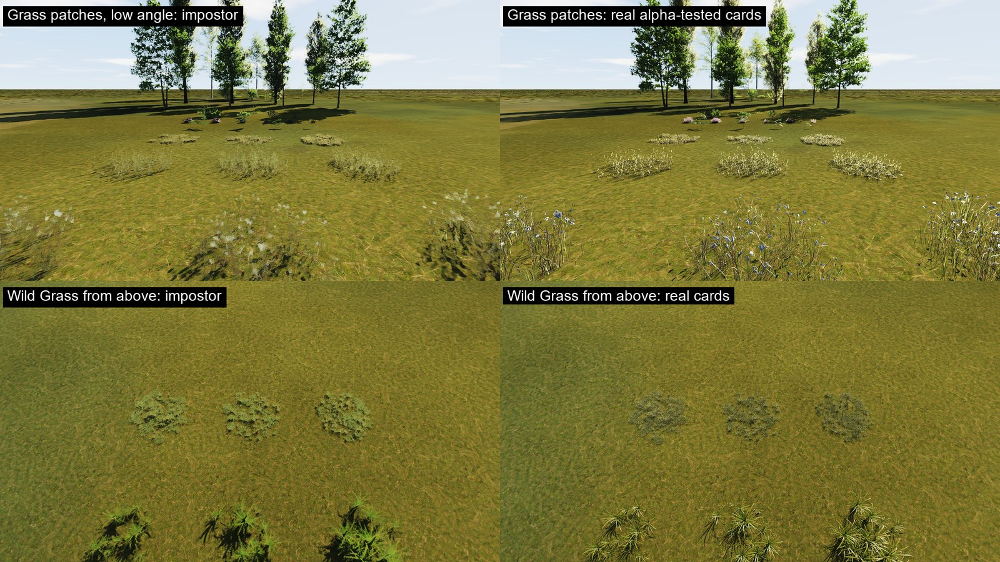

#### Lawn: short grass with no geometry (`--lawn on`, experimental)

Short grass is the worst case for the patches above: it is everywhere, a few centimetres high, and
every ray that grazes the ground stops at one patch box after another. The lawn is the impostor
technique turned on its side, with nothing in the acceleration structures beyond the first metres
around the camera:

- **One tile of real blades** (`src/lawn.rs`: 0.42 m, ~5,300 curved, tapering blades up to 4.5 cm,
  in clumps; `--lawn-height` sets the height) is baked once like a plant, between copies of itself
  so the result wraps around.
- **Views laid out for a ground cover.** A view from direction f stores, for the line along f
  through every point of the plane of the blade tips, the height of the first blade on that line,
  plus its colour, normal, coverage and sky visibility: a height map sheared along f. The plants'
  hemisphere grid has only a handful of views below 20°, where a lawn is nearly always seen, and
  smears it into streaks. So the lawn has 16 azimuths x 12 slopes, spaced geometrically in
  cot(elevation) from 79° down to 2.4° (a standing eye sees the lawn through its own views out to
  ~40 m): 192 views of 320 texels, one 5120x3840 atlas (85 MB).
- **Marched in the terrain's hit shader** (`shaders/lawn.glsl`). A ray that hits lawn-covered
  ground is backed up to the top of the blade slab and marched down through the nearest view with
  wrap-around lookups, the same coverage-per-crossing march as `impostor.rint`. A hit moves the
  surface up to the blade and takes its colour, normal and visibility; a miss shades the soil
  between the blades, darkened by them.
- **Self-shadowing** uses the view nearest the sun as a shadow map of the tile; trees still shadow
  the lawn through the ordinary shadow ray.
- **No rows of repeats.** One square repeated shows as lines: every clump lines up with its
  copies along every direction of the grid. So each copy of the tile is shifted by its own random
  amount (the tile wraps, so a shifted copy is whole), with ragged borders between copies. Blade
  height also varies over a few metres and in tufts a foot across, the tile coordinates are bent
  by a slow noise, and the colour follows the ground layers underneath.
- **Thin in flat views.** A point counts as blade if it is just behind the first blade on its
  line; in a flat view that depth is kept to one blade height along the ground, or blades seen a
  few degrees off their view smear sideways.
- **LOD is the mip chain.** Far lawn is a coarser level of the same atlas, fading into the ground
  texture by 220 m.
- **Real blades around the camera.** A layer inside the ground has parallax but no silhouette,
  and its blades stand in front of nothing: fine for a lawn seen from standing height, flat for
  anything taller or closer. So within a few metres of the camera the tile itself is drawn as
  geometry: one instance of its mesh per square of the grid, sheared onto the terrain and turned
  one of four ways. They are the same blades the layer was baked from, tinted the same way. 4 m
  of a lawn, up to 30 m of tall grass (`--lawn-near`); a few hundred to a few thousand instances
  of one BLAS.
- **The hand-over is blade by blade.** Towards the edge of that circle whole blades drop out one
  at a time, by the distance of their own root from the camera (`tri.rahit`), while the layer
  fades in under them: there is no edge of tiles to see and nothing shrinks.
- **One height field for both.** How much of its height the grass stands at is one continuous
  function of the place (`shaders/lawnh.glsl`): the layer squashes its blades by it, and each
  real blade is trimmed to its value at the blade's own root, so neighbouring tiles grade into
  each other instead of stepping.
- **Automatic length (`--lawn auto`).** The grass is long where it would be left to grow and
  short elsewhere, from a map built with the scene (`World::build_grass_map`): long under and
  around trees, in hollows and in patches of rough with ragged edges, short on the open ground
  between, blended over a few metres. One tile baked at the long height (32 cm) serves both;
  the short grass is 4.5 cm.
- **Quality (`--grass low|medium|high|ultra`, key B)** scales how far the real blades and the
  layer are drawn: 0.35x, 0.65x, 1x and 2x (ultra: real blades to 58 m of tall grass, the layer
  to 440 m). In the park all four trace in 1.6 to 1.9 ms at 1080p; ultra adds about 3,000
  instances.
- **Any height.** `--lawn meadow` (22 cm) and `--lawn tall` (45 cm), or `--lawn-height` in cm, are
  the same layer: the tile is four blade heights across, the blades grow wider and fewer, and
  unmown grass has blades of every length, arching, with seed stalks. In the forest scene a
  meadow also stands in for the tall and dry grass patches.

With the lawn on, the biome's short grass patches are thinned to a fifth (`--lawn 0.3` keeps 30%;
116,223 patches become 73,071 in the default scene) and the taller, dry and wet grasses stay as
its tufts. Ray tracing time at 1440p, DLSS Quality, median of three alternating runs (measured
with the first version of the lawn: 8.5 cm blades, 96 views, a 42 MB atlas):

| View | Lawn | Patches only |
|---|---|---|
| Clearing, eye height | 5.79 ms | 6.54 ms |
| Forest interior | 6.69 ms | 7.00 ms |
| From 45 m up | 4.69 ms | 4.83 ms |
| Standing, looking across | 7.63 ms | 7.97 ms |
| Looking down at the ground | 4.26 ms | 4.77 ms |
| Eye 0.5 m above the ground | 7.40 ms | 7.29 ms |

GPU memory was 4.24 GB against 4.20 GB (the atlas is 43 MB larger now). The march itself is nearly free (laid over the full grass
its cost was within run-to-run noise, except 0.3–0.5 ms looking straight down); the time saved is the patch boxes that
are no longer there.

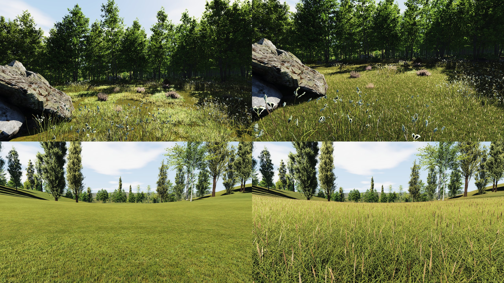

*Top: the default clearing with grass patches only, and with `--lawn meadow`. Bottom: the park's
mown lawn and its tall grass (`--lawn tall`), both from 0.75 m.* It is off by default: see
[Limitations](#limitations).

**The park (`--park`)** is a scene made for it: rolling hills of lawn and nothing else on the
ground, with the biome's trees in groves and a few standing alone (about 8,800 within 1.4 km), and
higher hills behind. There are no grass patches, shrubs or rocks, the lawn runs up to the trunks,
and its blades are kept nearly even, as mown. It starts on foot (see [Controls](#controls)) and
runs at about 4 ms a frame at 2560x1080 with DLSS Quality on an RTX 5080.

```
cargo run --release -- --park
```

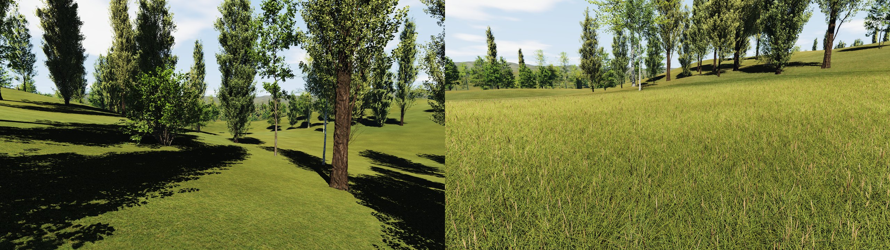

*The park as a lawn, and with `--lawn tall`.*

### 6. LOD and draw distance

| Distance (x the variant's LOD scale) | Representation | In the TLAS |
|---|---|---|
| < 44 m | real mesh | one instance per part, `FORCE_OPAQUE` (non-opaque for alpha-tested cards) |
| 44–56 m | both | parts non-opaque with a dissolve any-hit (`tri.rahit`), plus the impostor |
| > 56 m | impostor | one AABB |
| 0.8–1x draw distance | impostor dissolving out | small plants only |

The LOD scale is the plant's height / 16 m, clamped to 0.25–1.2 (grass at least 0.4). A 32 m
poplar switches at 60 m, a fern at 12.5 m. Plants under 2 m are drawn to 120 + 60 m per metre of
height, plants under 6 m to 450 m. The CPU keeps a per-plant state machine with hysteresis and
rebuilds the instance list only when a plant changes state; the shaders compute the fade from the
exact distance every frame, so the transition is continuous. An 8M-instance budget keeps very
long mesh distances from exhausting GPU memory.

**Impostor boxes in cells.** The forest scene's plants are grouped into 192 m cells, one AABB
BLAS per cell with one box per plant, and a record per plant (its transform, variant and seed).
2.6M of the 6.2M plants have a draw distance (hazel,
shrubs, ferns, grass): the intersection shader drops them beyond it, so their boxes are only
worth having near the camera. A cell's permanent BLAS holds just the plants that are never
culled; while the camera is within the draw distance of a cell, the TLAS shows a complete BLAS of
it instead, built inside the frame when the cell comes into reach and freed when it is left
behind. The picture is the same, and the far cells' boxes take no memory.

### 7. Terrain, rivers, forest growth and ground

**Terrain from erosion.** `erosion.rs` lifts a 144 km landscape by a tectonic uplift field and cuts
it down with rivers, using the stream-power law solved implicitly (Braun & Willett 2013; Cordonnier
et al. 2016). Every iteration a priority-flood pass (Barnes et al. 2014) routes all water to the sea,
and the drainage area is accumulated. Branching valleys, ridges and basins come out of the
simulation; the result is cached in `assets/cache`. Rivers are the cells draining more than 12 km²,
traced into smoothed, meandering polylines with widths from their catchment and a water level that
only falls downstream. Floodplains, banks and a riverbed are cut along them. The mesh is 3 m near
the start, grows to 200 m cells out to ±60 km, and carries the Earth's curvature.

**Forest growth as succession.** Trees are grown, not scattered:

- founder pairs on a 60 m lattice where the site allows forest, then 10 generations (~150 years)
  of seed dispersal;
- pioneers (aspen in root-sucker groves, poplar and alder in thickets) colonise open ground and
  gaps; shade-tolerant beech establishes under them and overtops them;
- every species has a lifespan and an age of first seeding; windthrow gaps of all sizes reset
  patches early on;
- a seedling fails under a crown two generations older within 5.5 m (light competition).

The result is a mosaic of stand ages and species, with alder and poplar along the rivers and
meadows on the valley floors (~6M trees in an 8 km radius). Shrubs, ferns and grass are scattered
on jittered grids from the simulated canopy cover.

Growing the forest takes ~23 s, and it is a pure function of the terrain, the biome, the radius
and the code, so the result is cached in `assets/cache/forest` under a name made of all of them
(the code as a hash of `world.rs`, `biome.rs` and `erosion.rs`, taken at build time). The next
start reads it in a fraction of a second; a changed input or changed code grows a new one, and
`SI_REGROW=1` forces it.

The ground blends twelve scanned surfaces found in the Fab library cache: forest floor, mossy
grass, uncut grass, dried grass, two rock cliffs, snow, gravel, lichen rock, riverbed, pebbles and
wet grass:

- **Biome mask:** a 1024² mask is built at startup from the actual tree crowns (canopy cover),
  moisture, dryness and understory density. Leaf litter goes under closed canopy, moss on wet
  ground and under scattered trees, grass and dry grass in the open.
- **No visible repetition:** hex-tile stochastic texturing (Mikkelsen 2022). The plane is split
  into hexagons and every lookup blends three samples, each with its own random rotation and
  offset, with contrast-preserving weights.
- **Natural edges and large-scale variation:** layer boundaries are perturbed by noise at ~3, 16
  and 80 m, and open ground varies in brightness and hue over tens of metres.
- **Height-based blending** (grass blades over litter), and a per-layer gain: the scans' mean
  albedos differ about 10x.
- **Landform-driven layers:** leaf litter only under the simulated crowns; dry grass on convex,
  sun-facing ground and lush grass in hollows; rock where it is too steep for soil (triplanar, with
  strata), scree and snow by altitude zone; pebble bars, mud and wet grass along the water.
- **Water:** rivers and lakes have a bed below the water surface. The ray-gen shades the surface
  over the bed: absorption with depth (Beer-Lambert) and in-scattering, sunlight attenuated down to
  the bed, flowing ripples, foam where it is shallow, a ray-traced reflection by Fresnel, the sun
  glint, and wet banks.

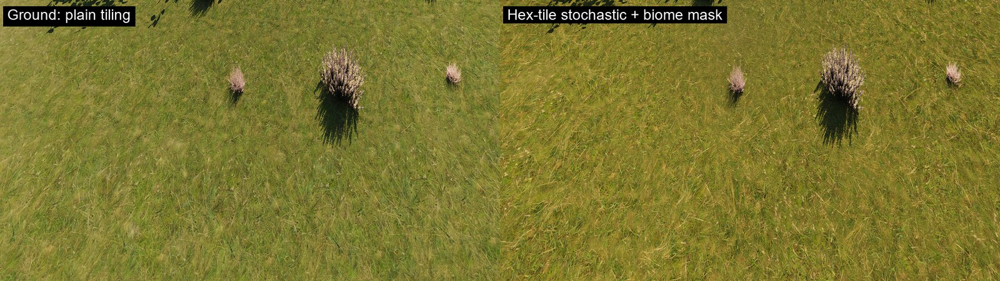

**Biomes (`--biome`).** The eroded terrain can carry any of eight biomes (`src/biome.rs`):
`temperate` (the default), `boreal`, `rainforest`, `savanna`, `desert`, `tundra`, `mediterranean`
and `alpine`. The terrain stays the erosion simulation's; a preset decides what grows on it and how
the ground looks:

- **Canopy:** the succession works with six ecological roles (shade-tolerant climax trees, trees
  of wet ground, edge pioneers, clonal groves, an understory tree, others). A preset fills them with
  its species: spruce over birch pioneers and aspen groves in the taiga, Aleppo pine and oak in the
  Mediterranean, broad crowns, bamboo and palms in the rainforest. It also sets how much of the
  land is forest, how wide the strips along the rivers are (a ribbon of willows and palms at the
  water in the desert), how far apart the trees stand (open savanna) and how tall they grow (dwarf
  birch and willow in the tundra).
- **Understory:** shrubs, forest plants and grasses, each with the habitat it grows in (open
  ground, forest edges, under the canopy; moist, dry or wet grass), plus boulder fields (clustered,
  and under steep ground) and deadwood.
- **Ground:** the 12 ground slots of `tri.rchit` (forest floor, moss, grass, dry grass, rock,
  snow, scree, mud, pebbles, wet grass) map to any of the 26 scans: sand and arid soil in the
  desert, red clay in the rainforest, tundra and lichen ground, boreal moss.
- **Climate:** plants' dryness tint, how dry and wet the ground is, the treeline and snow line
  (higher in the tropics and deserts, lower in the tundra), and a default sun, haze and exposure.

| | |
|---|---|
| 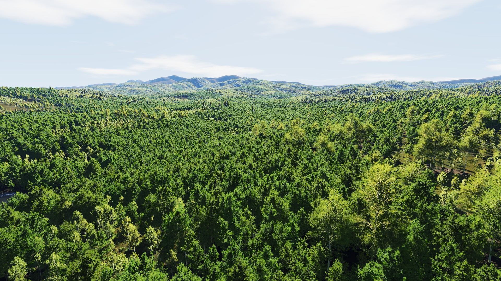 `temperate` | 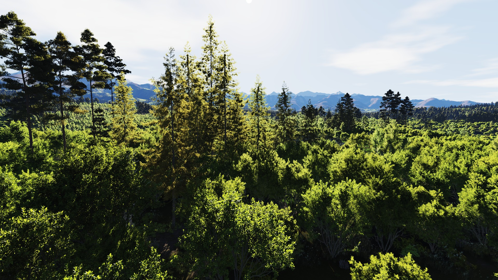 `boreal` |
| 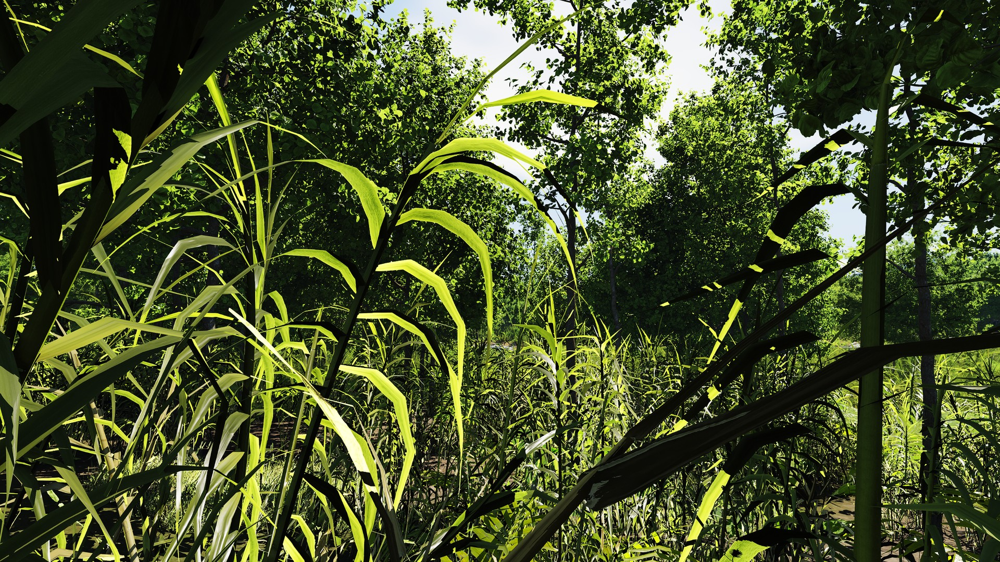 `rainforest` | 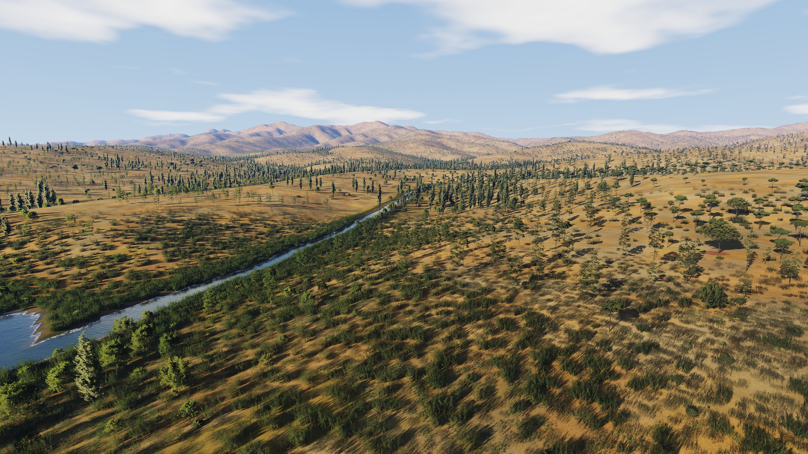 `savanna` |
| 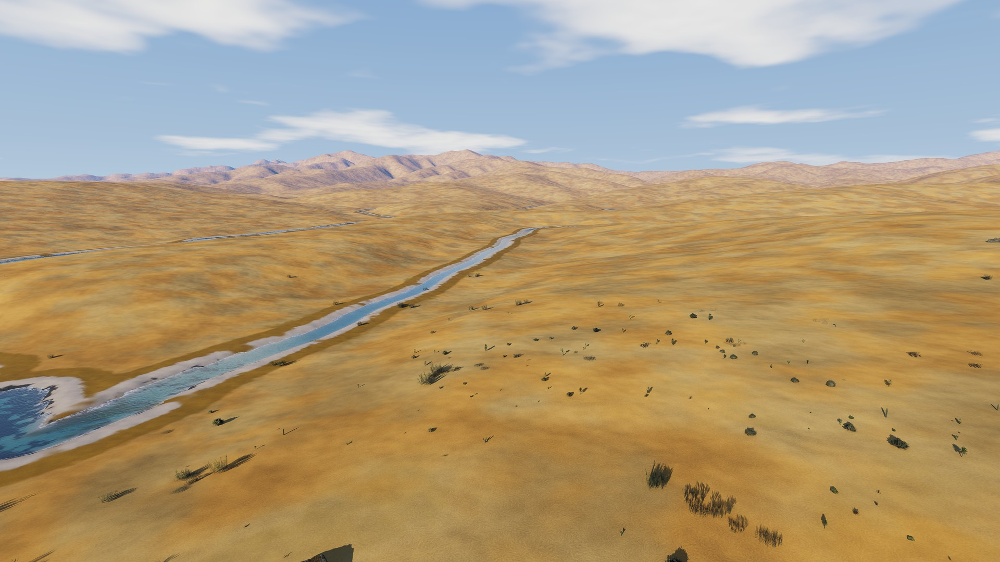 `desert` | 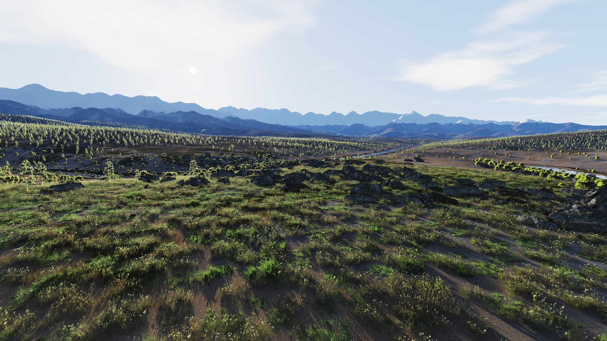 `tundra` |
| 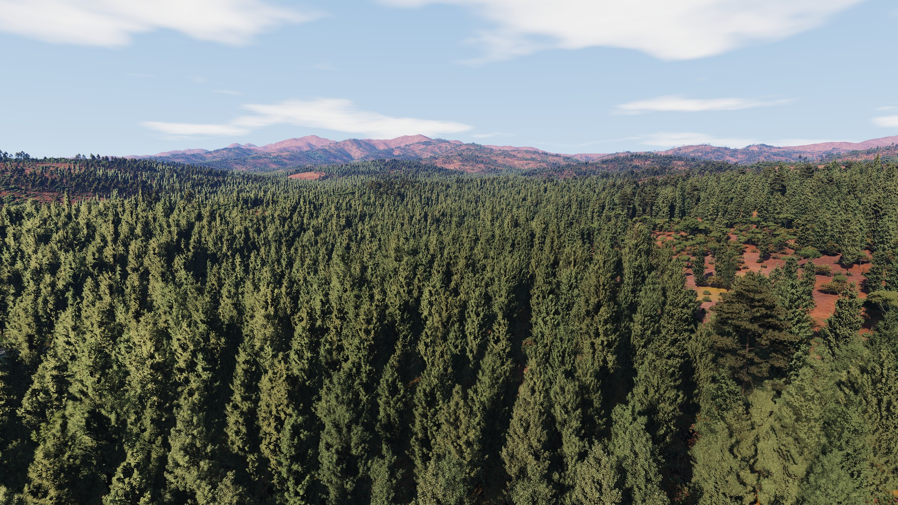 `mediterranean` | 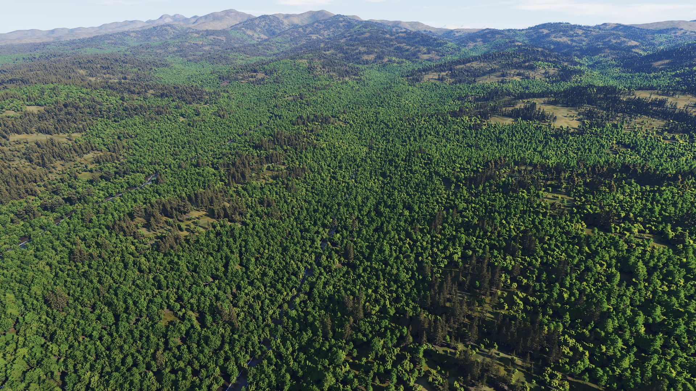 `alpine` |

### 8. Materials


`tri.rchit` shades leaves and bark with each species' textures (4 per species, selected by the
mesh's texture set):
- **Leaves:** colour, normal map, and a translucency map. Transmitted light is leaf albedo x the
  Unreal material's translucency tint x the translucency mask, like Unreal's two-sided foliage.
- **Per-species normalisation:** Megaplant colour maps are authored very differently (Unreal's
  material darkens the pale ones), so the foliage brightness and the translucency mask are
  normalised per species from texture statistics at load time. Grass is matched to the ground it
  stands on.
- **Bark:** colour, normal, and AO.
- **Normal mapping:** a tangent frame built per triangle from the UV gradients.
- **Mip selection:** a ray cone (hit distance x pixel spread vs texel size on the triangle), using
  the output-resolution footprint when DLSS upscales.
- **Leaf variation:** a subtle per-leaf colour change from the converter's leaf ids, and paler
  undersides.

### 9. Frame: DLSS Ray Reconstruction (or TAA)

`main.rgen` traces one primary ray per pixel and computes direct sun light (one traced shadow
ray), leaf transmission, specular, sky ambient with one traced AO ray, and a procedural sky with
clouds. That's noisy by design: the dissolve bands, the stochastic impostor view and coverage, the
single shadow and AO rays all rely on temporal accumulation.

**With DLSS Ray Reconstruction** (`native/dlss_shim.cpp`, `src/dlss.rs`), `main.rgen` also writes
the G-buffer NGX needs: linear view depth, per-pixel motion (each hit point reprojected into the
previous camera), world normal + roughness, diffuse albedo, and pre-integrated specular albedo.
DLSS-RR denoises and upscales from the render resolution to the display, then `resolve.comp`
tonemaps (ACES) and `sharpen.comp` applies contrast-adaptive sharpening.

Details that mattered:
- **Jitter:** the samples use a Halton(2,3) sequence (32 frames). NGX wants the offset of the
  *projection*, the opposite sign of where the samples sit. Measured: all four sign combinations,
  both-flipped clearly sharpest.
- **Texture mips:** with upscaling, textures are sampled for the output pixel footprint.
- **Required Vulkan extensions** are queried from NGX and enabled when the driver offers them.

**Without DLSS** (or `--dlss off`), the frame goes through `taa.comp`: reprojection, 4x4
Catmull-Rom history, depth-based disocclusion rejection, YCoCg variance clipping, Karis weighting,
and an exact running average when the camera is still. `resolve.comp` then downsamples from the
supersampled resolution, tonemapping each sample before averaging.

### 10. Performance work

The goal was speed without any visible change at DLAA. Every candidate was measured with GPU
timestamps and compared with the previous build's image (old and new builds run alternately,
twice). These were measured on the first, smaller forest (440k plants in a 1.4 km radius):

| Change | Result |
|---|---|
| **Shader Execution Reordering** (`hitObjectTraceRayNV` + `reorderThreadNV` for primary rays) | ray tracing 5–9% faster, same image |
| **CPU/GPU overlap:** the LOD update for 440k plants and the instance list are built before waiting for the previous frame; only the upload waits | fly-through median 13.5 → 11.0 ms |
| Overall at DLAA | 4–7% faster in still views, 15–18% in the fly-through; image differences at the run-to-run noise floor |

Tried and dropped:

| Idea | Why not |
|---|---|
| Opacity micromaps for the grass cards | Megascans cards already hug the blades: 60–100% of the card area would still be "unknown" and need the any-hit |
| Ground AO rays skipping grass | 17% faster from above, but the ground between blades got visibly brighter |
| Cheaper impostor march for AO rays | no measurable gain |
| Separate R8 opacity textures for the alpha test | no measurable gain |

A later pass on the 6.2M-plant forest was about GPU memory (8.3 GB -> 4.2 GB, same image, same
frame time): loading only what the scene shows, cropped impostor frames, cells that keep
draw-distance plants out of the far field, no terrain index buffer. Profiling it showed where the
ray tracing time goes: a fixed cost for every plant box a ray stops at (halving the impostor march
steps, or the ground shading, changes nothing; shrinking the boxes by 30% saves 15%). What that
ruled out:

| Idea | Why not |
|---|---|
| Up to 3 stacked hull boxes per plant (thin at the trunk, wide at the crown) | these trees branch almost to the ground: no gain, +105 MB of BLAS |
| A cylinder bound around each plant's axis instead of its turned box | crowns are not round enough: within noise |
| A 32-byte plant record (position + scaled quaternion) instead of the 3x4 matrix | 125 MB less, but ~5% slower: the unpacking runs for every box |

The remaining cost is primary rays through dense grass (any-hit invocations) and the fixed DLSS-RR
cost at DLAA; DLSS-RR Quality halves the frame time for a slightly softer image.

## The Earth: a 1:1 globe and real places

The plan for the whole planet at true scale is in [docs/EARTH_PLAN.md](docs/EARTH_PLAN.md). Built
so far:

- **`--globe`: the planet at 1:1, in the same renderer.** A cube-sphere quadtree of terrain tiles
  from orbit down to ~5 m cells, streamed in as you fly. Positions are float64 on the CPU and
  camera-relative float32 on the GPU, so it holds still from orbit to standing height. The globe is
  a mode of the main renderer, so it keeps the same path tracing, DLSS Ray Reconstruction / TAA,
  AO, mesh LOD band and see-through water. A single-scattering atmosphere (Rayleigh + Mie) gives
  the sky, sunlight, sky light and aerial perspective from the ground to space.
  - Trees to the horizon: tree tiles out to the visible horizon (`sqrt(2Rh)` from the camera
    height, plus a ridge allowance). Every tree is placed within 6 km; coarser tiles further out
    keep 1/4^k of the trees at their true size, and the terrain shader adds the canopy colour of
    the ones left out. Near the camera the trees switch to meshes through the usual LOD band,
    and grass, ferns and shrubs grow from the 20 m land cover within 700 m.
    - Tree thinning, smooth or stepped (`--tree-thinning smooth|stepped`, key N; smooth by
      default). Smooth: trees also thin out continuously with distance inside each tile
      (impostor.rint rejects a tree once its distance asks for less than its tile's density;
      `thinLevels` in rt.glsl), so the density meets the next tile level's at every tile edge and
      the canopy colour follows the same curve: no density squares from the air. Rays pass
      through the trees that are thinned out, so it can cost a little in dense forest.
      Stepped: one density per tile, the canopy colour by whole levels; tiles of
      different levels meet with a visible density step from high up. (Measured at Lake Como,
      2560x1392 DLSS Quality: smooth 11.28 ms, stepped 11.32 ms average, within run-to-run
      noise.)
  - Clouds (`shaders/clouds.glsl`, noise from `src/cloudnoise.rs`), after Schneider's Nubis
    (Horizon), Hillaire's Frostbite sky and Wrenninge's multiple scattering:
    - Three layers fixed to the Earth: low clouds from 600 m (stratus and stratocumulus ~1 km
      thick, cumulus to ~3 km, cumulonimbus towers with anvils to 11 km), altocumulus at
      3.5-5 km, cirrus streaks at 8-9.5 km drawn out along the wind.
    - Where they form: the equatorial band of towering convection, clear subtropics and
      deserts, marine stratocumulus decks off subtropical west coasts (ocean with land to the
      east), the cloudy mid-latitude storm tracks, polar stratus; weather systems of ~800 km and
      cells of ~12 km that grow and decay over tens of minutes; `--cloud-cover` scales it all.
    - Shapes from tiling 3D noise textures built once and cached: Perlin-Worley billows eroded by
      Worley fBm, a height profile per cloud type (flat bases, rounded tops), wispy below.
    - Light: sunlight marched towards the sun and summed over three scattering octaves
      (multiple scattering: bright, soft interiors), the droplet phase function of Jendersie &
      d'Eon 2023 (Henyey-Greenstein + Draine fitted to Mie: silver linings, fogbow and glory
      lobes), darker thin edges seen away from the sun (powder), light diffused down through the
      cloud above (1 / (1 + 0.75 tau (1 - g)): thick parts darker on the base), sky light from the
      atmosphere and the sunlit ground's bounce. Clouds shadow the ground through all three
      layers, dim the sky light under them and show in water reflections.
    - About 3.2 ms at 2560x1392 (Lake Como, 15.0 vs 11.8 ms); `--clouds off` or key U.
    - **The forest scenes have the same clouds** (the generated forest, a site, the park), in
      place of the cumulus painted on their sky. A planet is put under the scene, whose terrain
      already carries the Earth's curvature, so the same march runs unchanged; the weather is a
      fair day's (fields of cumulus with a base ~850 m over the start, a little altocumulus and
      cirrus, `--cloud-cover` scales it). They are lit by the scene's own sun and sky fill, in
      its sky's brightness, and fade into that sky with distance. Their shadows drift over the
      land, with the shadow density eroded as the visible clouds are (the coarse density alone
      shades far beyond the cloud one sees), and in a shadow the fill light turns grey and
      brighter. About 0.3 to 0.6 ms at 1080p; `--clouds off` (key U) brings the painted sky back.

      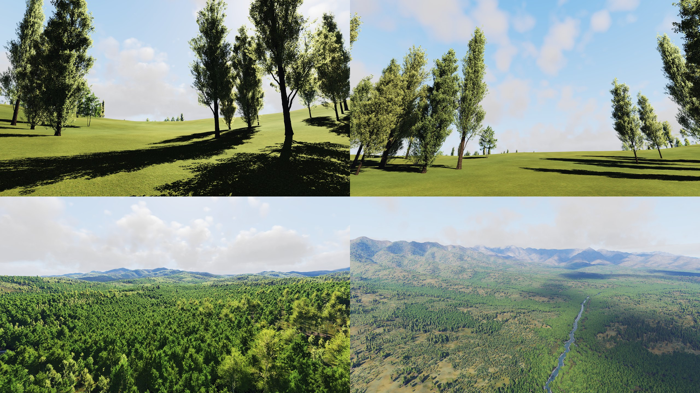
  - Atmosphere: ozone absorption, and samples packed towards the eye with each one dimmed only to
    its own middle, so the horizon is pale and hazy rather than a brown band.
  - The sea (`src/globe/ocean.rs`, `shaders/main.rgen`), built the way film and game oceans are
    (Tessendorf, "Simulating Ocean Water"):
    - Waves from a measured spectrum: JONSWAP wind sea plus a narrower swell, directional
      spreading, deep-water dispersion. Four FFT cascades (1024, 256, 64, 16 m patches, 128^2)
      on a background thread (~5 ms a step, overlapped), with choppy displacement (sharp crests,
      round troughs), slopes and the Jacobian, uploaded each frame as RGBA16F textures with mips.
    - Wind by region: trade winds, calm doldrums, westerlies (strongest in the Southern Ocean),
      polar easterlies, varied by weather patterns; the spectrum follows the camera's place.
    - Real wave geometry within 1.5 km: every view ray is marched through the slab the waves
      fill and stops on the height field (bisection-refined), so crests hide the troughs behind
      them and the skyline is made of waves; further out the cascades are normal detail.
    - Roughness from physics: what the mips average away plus the Cox-Munk slope variance below
      the finest cascade (0.003 + 0.00512 U) drives the reflection blur and a Beckmann sun
      glitter, so the glitter path widens with the wind as over the real sea.
    - Whitecaps where the crests fold (lowest Jacobian), steered so their area matches the
      measured coverage for the wind (Monahan: 3.84e-6 U^3.41, ~1% at 10 m/s), fading over a few
      seconds, drawn as dense fresh foam with streaks trailing downwind.
    - Water colour by floor depth: clear deep blue over the open ocean (pure water absorbs red,
      barely blue), greener over the shelf; light glows through thin crests when the sun is
      behind them (after the Atlas GDC 2019 water BSDF); waves die out as the bottom shoals.
    - No repeating patches (stochastic tiling): each cascade is laid out on hex cells ~1.5
      patches across, every cell at a random offset and turned up to +-25 degrees about the
      wind, three cells blended per point (variance-preserving, slopes and displacements turned
      back); amplitudes rise and fall in wave groups, and the whitecaps cluster with them.
    - Cost at sea level (2560x1392, DLSS Quality): ~10.4 ms a frame with clouds.
    Lakes keep their own calmer wind ripples.
  - Streaming without hitches: one pool of worker threads builds terrain tiles (first) and grows
    tree tiles. Their vertex copies and BLAS builds are recorded into the frame's own command
    buffer, with no GPU waits. Storage is pooled and device-local: fixed slots for terrain
    vertices and BLASes, one plant record / AABB buffer, and size-class slabs for tree BLASes.
    Tile selection, instance lists and mesh LOD run while the previous frame is still on the GPU.
    A tree tile that is being replaced by a finer or coarser one stays until its replacement is
    in, so the forest never shows bare patches. The coarse terrain tiles above the drawn ones
    (and their siblings) are never evicted, so very fast flight lowers the detail gradually
    instead of dropping whole regions to a coarse tile. Moving fast, tiles are requested by their
    distance from where the camera will be ~30 frames later, so the ground ahead fills first.
  - Elevation: NOAA ETOPO 2022 (60″, global, land and seafloor), Copernicus GLO-30 (30 m) where its
    tiles are present, blended at the edges. The whole ETOPO grid also lives on the GPU for
    per-pixel coastlines and relief far away.
  - Land cover: ESA WorldCover 2021 (10 m) where present, as fractions per terrain vertex. They pick
    the Quixel ground scans (forest floor, grass, rock on cliffs, glaciers, gravel, wetland) and mark
    lakes and rivers.
- **Time, sun and moon.** A UTC clock drives the sun and the moon (Astronomical Almanac /
  Meeus formulas: sun to ~0.01 degrees, moon to ~0.3), so the Earth turns under them: day and
  night, the seasons, and from orbit the terminator sweeping across the planet. The moon has its
  real phase and brightness (~2.4 millionths of sunlight at full); at night it is the light, and the
  eye adapts (pre-exposure in main.rgen, so moonlit radiance survives the 16-bit targets). `,` `.`
  step an hour (Shift: a day), `/` cycles the speed (real time, a minute, an hour or a day per
  second, stopped); `--time 2026-06-21T19:30` starts at a UTC time.
- **Water and shores.** Every terrain tile carries a 64 x 64 signed distance to the shore (from the
  10 m land cover, ETOPO where there is none), filtered per pixel: coastlines and lake shores are
  smooth curves at any distance. The same field gives the depth (lakes shelve to ~18 m, the sea to
  ~12 m and then ETOPO's seafloor), so the water is see-through over its bed: shallows show the
  pebbles or sand, foam at the waterline, a wet strip and a pebble or beach-sand strip on the shore,
  deep blue sea and dark lakes further out.
- **Biomes.** RESOLVE Ecoregions 2017 (846 ecoregions in 14 biomes, `tools/bake_biomes.py` ->
  a 3.7 km grid) chooses per place:
  - which trees grow (globe/forest.rs `BIOME_TREES`: e.g. spruce, pine, birch in the taiga; beech,
    oak, maple, hornbeam in temperate forest; Aleppo pine and oak in Mediterranean scrub; palms in
    oases and the tropics), with conifers taking over with altitude in temperate mountains and
    alders / willows / poplars on wet ground;
  - which understory plants belong there (bilberry and anemone in temperate and boreal forest,
    greasewood in deserts and steppe, ...);
  - which ground scans cover the land (globe.rchit: mossy forest floor in the taiga, red soil in
    the tropics, dry grass and red soil in savanna, sand and arid soil in deserts, tundra stones
    and lichen in the Arctic, mud in wetlands and mangroves, glacier ice, ploughed fields, beach
    sand on sea coasts).

  Species and scans are found by name: a Quixel asset that is not downloaded is skipped (the
  biome's other species, or a stand-in, take its place) and grows where it belongs once it is.
- **`--site lat,lon`: a real place in the forest renderer.** The local tangent plane at that point
  (with the Earth's curvature), heights from GLO-30 / ETOPO, lakes and rivers from WorldCover,
  streams from a priority-flood drainage of the real 30 m heights, and the forest grown only where
  WorldCover has tree cover. Altitude zones shift with latitude.
- **M** in site mode returns to the globe above the same spot.

**Data (free, not included).** `tools/fetch_earth.py` downloads it into `assets/earth/`
(resumable: stop and restart any time; `--bbox south,west,north,east` limits it to a region):

| Command | Folder | Dataset | Download | On disk |
|---|---|---|---|---|
| (by hand) | `etopo/` | [NOAA ETOPO 2022](https://www.ncei.noaa.gov/products/etopo-global-relief-model) 60″ ice surface, `ETOPO_2022_v1_60s_N90W180_surface.tif` | 466 MB | 0.9 GB |
| `fetch_earth.py dem` | `glo30/` | [Copernicus DEM GLO-30](https://registry.opendata.aws/copernicus-dem/), 26,450 1° tiles | ~543 GB | ~120 GB |
| `fetch_earth.py cover` | `worldcover/` | [ESA WorldCover 2021 v200](https://registry.opendata.aws/esa-worldcover-vito/), 2,651 3° tiles | 124 GB | 124 GB |
| `fetch_earth.py vectors` | `ecoregions/`, `hydrorivers/`, `hydrolakes/` | [RESOLVE Ecoregions 2017](https://ecoregions.appspot.com/), [HydroRIVERS / HydroLAKES](https://www.hydrosheds.org/) | 1.5 GB | 5.3 GB |

Elevation tiles are converted to a compact `.dem` file as they arrive (half-metre int16,
gradient-predicted, deflate: ~4.5x smaller than the GeoTIFF; `smart_imposter --convert-dem`).
Nothing is loaded up front: the workers decode elevation tiles and 1024 x 1024 land-cover blocks
the first time they need them and keep the recent ones in memory. Far terrain reads the land
cover's overviews (20 m ... 600 m pixels) instead of single 10 m pixels. The globe runs with
ETOPO alone; the 30 m elevation and land cover exist wherever their tiles are present.

Streaming on an RTX 5080 at 1920x1080, DLSS-RR Quality, `--bench-move` over 900 frames:

| Run | avg | p99 | max | frames > 33 ms |
|---|---|---|---|---|
| Flight at 300 m over Lake Como, 4 m/frame | 7.3 ms | 9.5 ms | 12.3 ms | 0 |
| Walk on an alpine slope, 0.3 m/frame | 6.3 ms | 10.2 ms | 11.2 ms | 0 |
| Flight at 1500 m, 15 m/frame | 7.1 ms | 11.0 ms | 15.5 ms | 0 |

Earlier, with synchronous per-tile uploads, the same runs had p99 64–68 ms and maxima of 76–110 ms.
A cold view streams in fully in ~1.8 s after the first frame (was 4.3 s).

The Quixel species (52 packs, 207 variants; docs/QUIXEL_DOWNLOADS.md): 16 trees (European beech,
black alder, black poplar, European aspen, common hazel, Norway spruce, Baltic pine, silver birch,
English oak, goat willow, Norway maple, Aleppo pine, dead pine, rowan, elder, giant bamboo), shrubs
and forest plants (heather, huckleberry oak, greasewood, European spindle, bilberry, wood anemone,
bracken, leather fern, Xanadu, Zamia, five palms, yuccas, dead shrubs), scanned props (cacti,
boulders, logs, snags), 13 grasses and 26 ground scans. Megaplants
are exported from Unreal with `tools/ue_export_megaplants.py` (the USD plugins must be enabled) and
converted with `tools/megaplant_to_mtree.py` (needs Pixar's `usd-core`); the Megascans glTF
downloads go through `tools/fab_to_mtree.py` and `tools/grass_to_mtree.py`.

GPU memory is kept in check without losing detail: textures are block-compressed on first use and
cached (`assets/cache/tex`): colour as BC7, normal x / y as BC5, single data channels as BC4,
>= 35 dB for almost all of them, a quarter of RGBA8 or less; static and streamed BLASes are
compacted (the tree meshes 1.9 -> 0.7 GB); tree AABBs are build input only; plant records carry
no padding; the terrain grid's triangles are worked out in the shader (no index buffer); the
forest scene loads only the species that grow in it; impostor frames are cropped to the plant and
atlases stream by need (see [Baking and compressing the
impostor](#2-baking-and-compressing-the-impostor)). Terrain tiles nothing has drawn for 4 s are
evicted, and empty vertex pool and BLAS heap chunks are given back, so memory stays flat when the
camera jumps across the planet. `SI_MEM=1` prints the GPU memory by allocation with the benchmark
output (and after each tour shot).

**Scripted tours and video** (`--tour`, `src/tour.rs`). A tour file is a list of shots: spline keys
(latitude, longitude, height above the ground, heading, pitch) with a local solar time, cloud cover,
date and exposure compensation per shot. Each shot waits in black until its terrain, trees, ocean
and full atlases have streamed in, then fades in, flies its keys with eased, constant-speed motion
and fades out. Animation steps a fixed 1/60 s per frame, so with `--tour-pace 40` (each frame on
screen for 40 ms) a 60 fps recorder captures every frame however heavy the scene;
`tools/record_tour.ps1` records it with OBS Studio and `tools/tour_post.py` drops the repeated
frames, cuts the loading gaps and adds titles, giving smooth 60 fps video.
[`tours/showcase.txt`](tours/showcase.txt) is a five-minute flight over ten forests.

**Test flight** (`--test-flight`, `src/flight.rs`, `src/pilot.rs`, `src/aircraft.rs`). An F-16C
flown over the globe, from a chase camera, the cockpit or a camera it flies past.

```
cargo run --release -- --test-flight                          # over Lake Como, heading for the Alps
cargo run --release -- --test-flight --at 32,-122,1000,90,0   # lat, lon, height above ground, heading
```


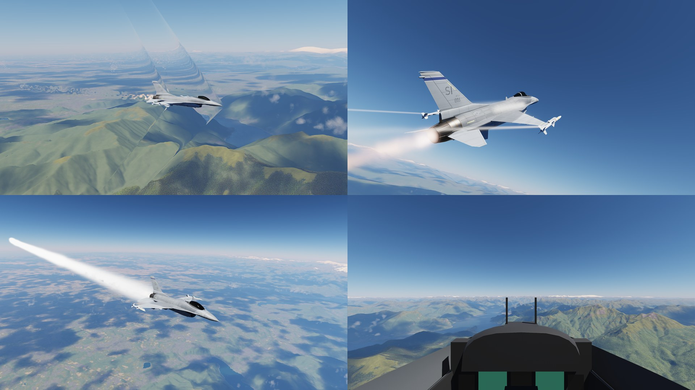

The model as Blender renders it (`tools/make_f16.py --renders`):


- **The aircraft** is built by `tools/make_f16.py` in Blender from published dimensions and a
  digitised three-view (the script's header says what is data and what is estimated), painted
  by `tools/f16_paint.py` and written as `assets/aircraft/f16c.acm` with its three skin maps.
  It is not in the repository: run the script once (`blender -b --python tools/make_f16.py --
  assets/aircraft`). It is ray traced like everything else, by its own hit shaders
  (`aircraft.rchit`, `aircraft.rahit`): the painted skin, flat materials, a mirror-gold canopy
  one looks out through from inside. The leading-edge flaps, flaperons, tailplanes and rudder
  move.
- **The flight model** (`flight.rs`) integrates lift, drag, side force, thrust and gravity in
  the 1976 standard atmosphere. The coefficients (by angle of attack and Mach number) and the
  engine (an F110-GE-129's 76 / 132 kN, falling with air density, rising with ram pressure,
  losing inlet recovery above Mach 1) are fitted to the aircraft's published performance, not
  taken from wind-tunnel tables: it tops out at Mach 2.10 at 12 km and Mach 1.29 at sea
  level (the real aircraft: about 2.05 and 1.2), with the transonic drag rise between. It is flown through the real aircraft's control
  laws: the stick commands load factor (+9 to -3 g, 1 g hands off) limited to 25.2 degrees
  angle of attack, and roll rate about the flight path (to 324 deg/s, less when slow or at
  high angle of attack); sideslip is held at zero unless the pedals ask for some. The moments
  themselves are not modelled (the computer's commands are followed with the airframe's lags),
  nor fuel, stores, landing gear or wind. Four unit tests hold it to 1 g hands off, the 9 g and
  angle-of-attack limits and the top speed.
- **As flown, it is tuned for play** (`Sim::arcade`, on in `--test-flight`), away from the real
  aircraft in two ways: 30% more afterburner and no inlet loss, so it reaches Mach 3.08 at
  12 km and Mach 1.62 at sea level; and A / D turn it (a 40 degree bank flown for you, plus up
  to 1.4 g of flat turn), where a real rudder only slips the nose a few degrees.
- **The air bends the light** (`aircraft.glsl` `craftBend`): supersonic, the bow shock and the
  tail shock are cones of denser air (half angle asin(1 / Mach)), and a ray is refracted going
  in and coming out, most where it meets the cone edge on. What is behind is looked for again
  along the bent ray, so the land and sky show two shifted lines trailing back from the
  aircraft; the exhaust makes what is seen through it shimmer. The bending is many times the
  real air's, which only a schlieren camera shows.
- **What speed does to the air** (`shaders/aircraft.glsl`), all thin volumes integrated along
  the view ray: the afterburner's flame with its shock diamonds; the veil of condensation
  round the aircraft between about Mach 0.9 and 1.09 low down (a ragged cone ending at the
  shock, its sunward side warm, the far side sky blue, pastel fringes where it is thinnest); vapour over the wings and in the tip
  and strake vortices above 4 g; a condensation trail where the air is colder than about
  -40 C (above roughly 8.5 km). Humidity is assumed by height, not simulated. There is no sound.
- **Clouds** (`clouds.glsl`): with an aircraft flying, the cloud samples crowd towards the
  camera (metres apart, not a kilometre), so one flies through cloud and not past a backdrop.
  The aircraft's wake, 32 points kept for 95 s and drifting with the wind, clears a tube
  through the cloud that widens from 9 m to ~140 m and turns the cloud's shapes about the
  path. Inside a thick deck that tube is what keeps the aircraft in sight of the chase camera;
  the lane it leaves in thin or broken cloud is subtle.

**Cities (`--globe`, work in progress).** A procedural city laid over a real place, drawn with
the same impostor system as the trees. The first one is Miami (`--globe --at 25.790,-80.140,150,250,-8`
looks west across Biscayne Bay at downtown):

```
cargo run --release -- --globe --at 25.770,-80.205,60,0,-20 --time 2026-11-26T20:00
```

- **Buildings as impostor variants** (`src/city.rs`). 41 archetypes are generated in code as real
  geometry: glass office towers (curtain walls with mullion fins and floor bands, setbacks, podium
  garages, mechanical crowns, masts), residential towers (slab balconies with glass rails, white
  bands), office blocks with ribbon windows, stucco apartment blocks with recessed windows, shops,
  hip-roofed and flat-roofed houses, parking garages, with parapets and rooftop plant. Each is a
  variant of a species of its own (`catalog.rs` `Kind::Building`): baked into a hemi-octahedral
  atlas like a tree (frames up to 768 texels, 4.5 cm x the LOD scale), placed by plant records in
  the tree tiles, its mesh within 220-440 m (LOD scale 5-10, by height), never thinned with
  distance, so the skyline stays whole to the horizon. Seen from the side and from above, which is
  how a city is seen, the upper-hemisphere atlas holds up: walls and roofs are flat and the parallax
  march puts them where they are.
- **Facades** (`shaders/building.rchit`, its own hit records, so the plants' atlases are not
  re-baked when it changes). Material ids and palettes per triangle; texture coordinates are facade
  cells (window column, storey), so each window has its own tint and reflectivity, mullions and
  spandrels are drawn where a pixel resolves them and averaged beyond. Glass reflects: `main.rgen`
  traces the reflection (the other towers, the bay, the sky) with Fresnel and the coating's tint, a
  dark interior behind it and a GGX sun highlight. The bake has no channel for glass, so it is
  carried in the length of the baked normal (the "normal spread", ~1 on flat facades anyway) and
  read back by `impostor.rchit`.
- **The plan** (`src/globe/city.rs`). A street grid on the city's tangent plane: arterials (22 m,
  every 6th / 5th street) and residential streets (14 m), blocks zoned by how close they are to the
  downtown cores (towers, office and apartment blocks, shops and walk-ups, houses), lots cut per
  zone. Every choice is an integer hash of the block and lot numbers, so any tile works out its own
  buildings, the trees keep out of streets and footprints, and the terrain shader
  (`globe.rchit cityGround`) draws the same plan on the ground: asphalt with lane paint, zebra
  crossings at the arterials, sidewalks with kerbs and verges, houses in rows facing their streets
  with lawns, driveways, patios, hedges and pools, shops on parking lots with stall lines, plazas
  with planters downtown. Buildings, streets and lots go only where the 10 m land cover says the
  ground is built up and dry, so the real coast, bay and islands shape the city. The 30 m elevation
  is a surface model with the real city's buildings in it: inside the city the ground is capped to
  the plain under them.
- **Light** (near a city, `Globals.city`): one traced bounce of light for the buildings and the
  ground instead of AO (a cosine ray, lit by the sun with its own shadow ray and the sky, or the
  sky where it escapes; DLSS Ray Reconstruction averages it), so walls in shade take up the sunlit
  street and the towers across it; humid coastal haze (5x the clear-day aerosol, `atmoHaze` in
  `atmosphere.glsl`): the skyline a pale silhouette a few kilometres out, the sun warmer; a softer
  tone curve (lifted toe, a little less saturation, warm highlights). `SI_CITY_GI=0`,
  `SI_CITY_HAZE=<x>` and `SI_CITY_GRADE=0` turn them off or change them for comparisons.
- **Trees** (`catalog.rs` `add_city_palms`). The library's palms are young plants of 1-2 m, so
  tall palms are built from them: a procedural trunk (7-14 m, tapering, some leaning, a crownshaft;
  the beech scan's smooth grey bark) carrying a young palm scaled up as its crown, four variants
  baked like any tree. They line the sidewalks (whole streets with or without), stand in the front
  and back yards, round the parking lots and in the plaza planters, all from the same hashed plan;
  the land cover's trees in a city are palms and broad crowns (oak, maple, beech standing in for
  live oaks and figs), never conifers, poplars or bamboo.
- **The waterfront.** Every city shore but sand beaches and mangroves is a seawall: the ground
  runs to a concrete cap with a dark wet face, the water is deep right up to it and has no lapping
  foam (`FLAG_SEAWALL`). In a city the waves feel the real (ETOPO) floor, so the swell dies out in
  the shallow bay and the canals while the open sea keeps it. Docks run out behind the waterfront
  houses, most with a boat moored; runabouts, cruisers and motor yachts (archetypes like the
  buildings, with timber and gelcoat materials) lie out on open water clear of the shore.
- **Massing and materials.** Two supertalls (320 and 290 m) give the skyline its peak; residential
  towers are white concrete with corner fins, frosted rails and pool decks on their podiums;
  downtown a tower stands at one end of its lot with a garage or shops podium filling the rest;
  every building has a wall tint of its own (whites, creams, pastels; the same in its mesh and its
  impostor, from its record's seed), dirt at the foot of its walls and rain streaks down them.
- **Still to do**: cars (the 256 variant slots are full: a plant record keeps its variant in 8
  bits), boat wakes, bridges and causeways, lights at night.

**Still to do** (see the plan): rivers from HydroRIVERS (the 10 m land cover has the wide ones),
stars, seasons in the vegetation, and wind.

## Getting started

### Requirements
- A GPU with Vulkan hardware ray tracing (`VK_KHR_ray_tracing_pipeline`, `VK_KHR_acceleration_structure`). Developed on an RTX 5080 (16 GB).
- About 4–5 GB of VRAM for the forest scene and 11 GB for the globe at the defaults (16 GB
  recommended for the globe). Lower it with `SI_IMPOSTOR_MB=2000`, `--imp-res 320`, `SI_TEX_MAX=1024` or
  `--species Beech,Alder` (forest scene).
- Rust (stable) and the [Vulkan SDK](https://vulkan.lunarg.com/), for `glslangValidator`.
- Python 3.12 with `usd-core`, `numpy` and `pillow`, for the asset converters.
- Optional, for DLSS Ray Reconstruction: an NVIDIA RTX GPU, the
  [NVIDIA DLSS SDK](https://github.com/NVIDIA/DLSS) and the MSVC C++ build tools.

### Plant assets (not included)

The plants are **Quixel Megaplants** and **Megascans** from [Fab](https://www.fab.com). Their
license doesn't allow redistribution, so this repository contains no assets. Get them yourself:

1. On Fab, add the Megaplants you want (for example Black Alder, Black Poplar, European Beech,
   European Aspen, Common Hazel, Common Heather, Huckleberry Oak, Bracken Fern) and add the
   **Unreal Engine** format to a UE 5.x project. Enable the Procedural Vegetation Editor plugin and
   Nanite Foliage. They land in `/Game/Megaplant_Library`.
2. Export meshes, assembly data, textures and material parameters headlessly:
   ```
   UnrealEditor-Cmd.exe <Project>.uproject -run=pythonscript -script=<repo>/tools/ue_export_megaplants.py ^
       -EnablePlugins=PythonScriptPlugin,EditorScriptingUtilities,USDImporter -unattended -nop4 -nosplash -NullRHI
   ```
   This writes `assets/megaplants/<Species>/`. `SI_ONLY=Beech` limits it to matching species.
3. Convert each species:
   ```
   python -m venv tools/.venv
   tools/.venv/Scripts/pip install usd-core numpy pillow
   tools/.venv/Scripts/python tools/megaplant_to_mtree.py assets/megaplants/Tree_European_Beech assets/species/Tree_European_Beech
   ```
   This writes `assets/species/<Species>.mtree` and `.json` (kind, textures, Unreal tints,
   variants, heights). The engine loads every pack in `assets/species`. Species are found by
   name: the forest scene grows the ones its biome preset names (`src/biome.rs`; any species with
   `--species`), the globe the ones its biome tables name (`globe/forest.rs`); a missing one is
   skipped.
4. Grass (optional): add Megascans 3D grass to your Fab library (Grass Clumps, Wild Grass, Tall
   Grass, Tufted Grass, Dry Grass, Cotton Grass), download the glTF format, and convert each:
   ```
   tools/.venv/Scripts/python tools/grass_to_mtree.py <FabLibrary>/Grass_Clumps-<id> assets/species/Grass_Clumps
   ```
   Options: `--patch 2.6` (patch diameter, m), `--patches 3` (variants), `--density 1.0`.
5. Other Megascans plants and props (optional): palms, ferns and yuccas (alpha-tested cards) and
   scanned solids (cacti, boulders, logs, snags), from their Fab glTF downloads:
   ```
   tools/.venv/Scripts/python tools/fab_to_mtree.py plant <FabLibrary>/<Plant>-<id> assets/species/Shrub_<Name> --kind shrub
   tools/.venv/Scripts/python tools/fab_to_mtree.py solid assets/species/Prop_<Name> <FabLibrary>/<Scan>-<id> [...]
   ```
   A `solid` group (all the cacti, say) becomes one species with a shared texture atlas; see the
   script's header for the options.
6. Ground (optional): add the Fab surfaces listed in `catalog.rs` `GROUND_LAYERS` (Forest Floor,
   Mossy Grass, Uncut Grass, Grass Dried, rock cliffs, snow, gravel, riverbed, pebbles, wet grass;
   glTF, 2K). The engine finds them in your Fab library cache: set `SI_GROUND_DIR` to it, at run
   time or at build time in `.cargo/config.toml` (`[env]`). Missing surfaces fall back to
   procedural stand-ins.

The older single-species route (USD download → `tools/usd_to_mtree.py`, textures via
`tools/ue_export.py`) still works: with no `assets/species` packs the engine loads
`assets/black_alder.mtree` and `assets/textures`.

### DLSS Ray Reconstruction (optional)

The DLSS SDK and runtime are NVIDIA's and are not part of this repository.

1. Get the [DLSS SDK](https://github.com/NVIDIA/DLSS) (it needs `include/` and
   `lib/Windows_x86_64/x64/nvsdk_ngx_d.lib`).
2. Point the build at it, for example in a local, git-ignored `.cargo/config.toml`:
   ```toml
   [env]
   DLSS_SDK = "C:/path/to/DLSS"
   ```
3. Put the Ray Reconstruction runtime `nvngx_dlssd.dll` in `assets/dlss/` (or set `SI_DLSS_DIR`).

The log says `DLSS Ray Reconstruction available` when it works; otherwise the engine explains why
and falls back to TAA.

### Build and run

```
cargo run --release
```

| Flag | Meaning |
|---|---|
| `--size 2560x1440`, `--fullscreen` | window size / borderless fullscreen |
| `--vsync`, `--validation` | present with vsync; Vulkan validation layers (also `SI_VALIDATION`) |
| `--dlss dlaa\|quality\|balanced\|performance\|ultra\|off` | DLSS Ray Reconstruction mode (default quality) |
| `--fly [--fly-speed 13 --fly-start 0]` | forest scene: automatic showcase fly-through (1.8 km loop): speed (m/s), start (m along the path) |
| `--ss 2` | supersampling factor for the TAA path (default 1.5) |
| `--lod 50`, `--lod-band 12` | mesh distance for a 16 m plant and dissolve band width |
| `--lod2 100`, `--lod2-band 24` | forest scene: high-detail to low-detail impostor distance and its band |
| `--ao 1` | AO rays per pixel (0-2; key O) |
| `--sun 35,38`, `--haze 1` | sun azimuth / elevation (degrees) and aerial perspective strength (forest scene; defaults from the biome) |
| `--species Beech,Fern` | load only matching species packs |
| `--asset path.mtree` | a single plant asset (the older single-species route, when `assets/species` is empty) |
| `--imp-texel 0.055 --imp-res 448 --imp-grid 12` | impostor texel size (m), maximum frame resolution, views per side |
| `--spacing 7 --radius 8000` | forest scene: canopy tree spacing and forest radius (m, the defaults) |
| `--sharpen 0.5`, `--no-taa` | post-processing |
| `--clouds on\|off`, `--cloud-cover 0.45` | volumetric clouds, in every scene, and how much of the sky they cover (0-1; on the globe before the weather systems and latitude belts); key U toggles them (off in the forest scenes: the painted sky) |
| `--tree-thinning smooth\|stepped` | globe: how distant trees thin out (see [Trees to the horizon](#the-earth-a-11-globe-and-real-places)); key N toggles it |
| `--shot out.png --frames N --cam x,y,z,yaw,pitch` | render N frames, save, print timings and the GPU profile, exit |
| `--views "x,h,z,yaw,pitch[,lod,debug];..."` | several cameras in one run (h above ground), one screenshot each |
| `--bench-move 0.25` | move every frame and print frame-time statistics |
| `--gallery` | every variant on flat ground, one row per species |
| `--park` | hills of lawn with groves and single trees, walked (see [Lawn](#lawn-short-grass-with-no-geometry---lawn-on-experimental)); `--biome` picks the trees, `--lawn off` shows the bare ground texture |
| `--walk on\|off` | start on foot instead of flying, in any scene: the forest, a site, the gallery, the globe, the park (its default). Key V switches |
| `--test-flight` | fly an F-16C over the globe (see [Test flight](#the-earth-a-11-globe-and-real-places)); `--at lat,lon,height,heading,0` sets the start. Needs `assets/aircraft/` from `tools/make_f16.py` |
| `--dump-atlas prefix` | write the first variant's uncompressed albedo atlas as a PNG |
| `--debug N` | 1 LOD view, 2 normals, 3 albedo, 4 AO, 5 sun visibility, 6/7 TAA history, 8 leaf transmission, 9 sheen (x16), 10 diffuse, 11 ground layers |
| `--biome temperate\|boreal\|rainforest\|savanna\|desert\|tundra\|mediterranean\|alpine` | what grows on the generated (eroded) terrain, its ground, treeline and light (see [Biomes](#7-terrain-rivers-forest-growth-and-ground)); `--sun` and `--haze` override the biome's |
| `--lawn on\|off\|0.2\|meadow\|tall\|auto` | forest scene: grass as a parallax layer in the terrain shader, real blades near the camera (see [Lawn](#lawn-short-grass-with-no-geometry---lawn-on-experimental)); a number is how much of the short grass patches stays (default 0.2); `meadow` and `tall` are 22 and 45 cm grass; `auto` is long around trees, in hollows and in rough, short elsewhere. Off by default |
| `--grass low\|medium\|high\|ultra` | how far the lawn is drawn, blades and layer (high is the default, ultra twice its distances); key B cycles |
| `--lawn-height 4.5` | the grass's height in cm (2 to 60; re-bakes its atlas) |
| `--lawn-near 10` | real blades around the camera out to this many metres (0 = the layer only; default by the height, 4 to 30 m) |
| `--site lat,lon` | build the scene from the Earth data at that place (see [The Earth](#the-earth-a-11-globe-and-real-places)) |
| `--tour tours/showcase.txt [--tour-pace 40]` | globe: fly a scripted tour (`src/tour.rs`: shots of spline keys, local time, cloud cover, exposure; black while each shot streams in, then a fade in and out) and exit. Each frame steps 1/60 s; with a pace above 16.7 ms it plays slower than real time so a 60 fps recorder captures every frame (`tools/record_tour.ps1` + `tools/tour_post.py` turn that into a 60 fps video). `SI_TOUR_STILLS=1` saves stills per shot |
| `--globe [--at lat,lon,height,heading,pitch] [--views "...;..."] [--time 2026-06-21T10:30] [--time-rate s]` | the 1:1 globe; `--views` takes the same five numbers per view; `--time` is UTC (default 10:30 local solar time on the June solstice), `--time-rate` simulated seconds per second (default real time, stopped when capturing); `--bench-move m` flies along the heading at constant height |
| `smart_imposter --convert-dem <tif>...` | convert Copernicus GeoTIFFs to the engine's `.dem` next to them (in parallel) and delete the GeoTIFFs (`tools/fetch_earth.py` runs it as tiles arrive) |

| Environment | Meaning |
|---|---|
| `DLSS_SDK` | (build) DLSS SDK root; enables Ray Reconstruction |
| `SI_DLSS_DIR` | folder with `nvngx_dlssd.dll` (default `assets/dlss`) |
| `SI_DLSS_JITTER` | DLSS jitter sign test: `+x` and / or `+y` pass the raw sample offset instead of the (measured sharpest) flipped one |
| `SI_NO_SER` | disable Shader Execution Reordering |
| `SI_VALIDATION` | same as `--validation` |
| `SI_PROF_SKIP` | profiling: 1 no sun-shadow rays, 2 no AO rays, 3 neither |
| `SI_TEX_MAX`, `SI_GROUND_TEX_MAX` | maximum plant / ground texture size (default 2048) |
| `SI_GROUND_DIR` | Fab library cache with the ground surfaces |
| `SI_IMPOSTOR_MB` | GPU memory for full impostor atlases (default 25% of VRAM) |
| `SI_REBAKE` | re-bake every impostor atlas instead of reading the cache |
| `SI_REGROW` | grow the forest again instead of reading the cache (`assets/cache/forest`) |
| `SI_ATLAS_LOG` | log full-atlas uploads (image creation and descriptor update times) |
| `SI_MEM` | print GPU memory by allocation with the benchmark output and after each tour shot |
| `SI_TOUR_STILLS` | `--tour`: save three stills per shot to `shots/` |
| `SI_STREAM_LOG`, `SI_TREE_STATS` | globe: log streaming every frame; tree tile statistics |
| `SI_NO_UNDER` | globe: no understory (profiling) |
| `SI_PARTS` | list every variant's parts and triangle counts at startup |
| `SI_FOREST_MAP` | print a coarse plant-count map |
| `SI_DUMP_ATLAS` | same as `--dump-atlas` |

### Controls

| Input | Action |
|---|---|
| Left click / Esc | capture / release the mouse (Esc again quits) |
| Right mouse | look without capturing |
| W A S D, Q / E (Space) | fly, down / up. Shift 4x, Ctrl 0.25x |
| V | walk / fly, in any scene. On foot: W A S D walk where the camera faces, Shift runs, Ctrl crouches, Space jumps; tree trunks are solid (not on the globe) |
| B | grass quality: low, medium, high, ultra |
| Mouse wheel | fly speed |
| C | cinematic smoothing |
| F | automatic fly-through on/off |
| L | DLSS Ray Reconstruction on/off |
| J | cycle DLSS mode: DLAA, Quality, Balanced, Performance, Ultra Performance |
| `[` `]` | mesh distance |
| `;` `'` | high- to low-detail impostor distance (forest scene) |
| G | aerial perspective on/off |
| 0–5 | debug views |
| K | supersampling 1x / 1.5x / 2x (TAA path) |
| T | TAA on/off |
| N (globe) | distant tree thinning: smooth (default) / stepped per tile |
| U | volumetric clouds on/off |
| H | sharpening strength |
| Arrow keys | sun azimuth / elevation |
| `-` `=` | exposure |
| O | AO rays per pixel |
| P | print the camera as `--cam` (globe: as `--at`) |
| M (site mode) | back to the globe above the same place |
| `,` `.` / Arrows (globe) | clock back / forward an hour (Shift: a day; up / down: a day) |
| `/` (globe) | clock speed: real time, 1 min/s, 1 h/s, 1 day/s, stopped |
| F11 / F12 | fullscreen / screenshot |
| **`--test-flight`** | |
| W / S (or Shift / Ctrl) | faster / slower (the keys are Grand Theft Auto V's for aircraft); past 100% the afterburner lights, held back past idle the speed brakes open |
| A / D | turn left / right: the aircraft banks into the turn and levels again after |
| Numpad 8 / 5 (or Up / Down) | nose down / up (a key asks for half of what the aircraft can do) |
| Numpad 4 / 6 (or Left / Right) | roll left / right |
| mouse, wheel | look round the aircraft (the cursor is locked to the window; Esc frees it, a click takes it back; the view goes behind the aircraft again 2 s after the mouse stops); chase distance |
| left mouse button (hold) | fly with the mouse: forward nose down, sideways roll |
| Space | speed brakes (hold) |
| C | view: chase, cockpit, fly-by |
| R | back to the start |
| **controller** (`--test-flight`) | a PlayStation controller (DualSense, DualShock 4: read directly over USB or Bluetooth) or any gamepad the system reports (Xbox); the layout is Grand Theft Auto V's too; it flies only while the window is in front |
| right / left trigger | faster / slower (held past idle: speed brakes) |
| left stick | the stick: forward nose down, back nose up, sideways roll (gentle near the centre, all the aircraft can do at the rim) |
| bumpers | turn left / right, as A / D |
| right stick | look round the aircraft |
| A / Cross | speed brakes (hold) |
| View / Select (or Y / Triangle) | view: chase, cockpit, fly-by |
| D-pad up / down | chase distance |
| Menu / Start | back to the start |

## Tools

| Script | Purpose |
|---|---|
| `tools/fetch_earth.py` | download the globe's data (Copernicus GLO-30, ESA WorldCover, ecoregions, rivers, lakes) into `assets/earth/`, converting the elevation tiles as they arrive |
| `tools/bake_biomes.py` | rasterise the RESOLVE ecoregions into the globe's biome grid (`assets/earth/ecoregions/eco_grid.bin`) |
| `tools/ue_export_megaplants.py` | run inside Unreal: export every Megaplant's meshes, Nanite assembly hierarchy, textures and material parameters |
| `tools/megaplant_to_mtree.py` | flatten an exported Megaplant into `.mtree` + species `.json` |
| `tools/grass_to_mtree.py` | Megascans 3D grass (Fab glTF) → grass-patch species pack |
| `tools/usd_to_mtree.py`, `tools/ue_export.py` | single-species route from a Fab USD download |
| `tools/compare.ps1`, `tools/grid.py`, `tools/treestats.py` | render the same view as impostors and as meshes in several debug modes, lay the pairs out in a labelled grid and compare tree-pixel statistics |
| `tools/sweep.ps1`, `tools/sweep_plot.py` | tree brightness vs camera distance, smooth vs hard LOD switching |
| `tools/fab_to_mtree.py` | Megascans plants (alpha-tested cards: palms, ferns, yuccas) and scanned solids (cacti, boulders, logs, snags, sharing one texture atlas) from Fab glTF → species packs |
| `tools/usd_inspect.py`, `tools/usd_details.py`, `tools/uv_check.py`, `tools/leaf_check.py` | asset inspection |
| `tools/make_docs_images.py` | build the README images from renders |
| `tools/make_f16.py`, `tools/f16_paint.py` | run in Blender: build the F-16C of `--test-flight` from published dimensions and a digitised three-view, paint its skin atlas, write it for the renderer (`.acm`) and as glTF |
| `tools/record_tour.ps1` | record a `--tour` with OBS Studio (profile setup in the script header) |
| `tools/tour_post.py` | recorded tour → finished video: finds the shots, drops repeated frames (paced recording), dips to black between shots, title cards and lower thirds from the tour file, H.264 60 fps |

## Code layout

```
src/
  main.rs       window, input, fly-cam, multi-view capture, the tour player, CLI
  renderer.rs   pipelines, SBT, what a scene loads, impostor bake + BC compression, frame crop,
                atlas streaming, plant cells, LOD state machine, TLAS, DLSS / TAA / resolve /
                sharpen passes, GPU profiling
  atlas.rs      impostor atlas cache files, stream layout, the loader thread, upload ranges
  dlss.rs       DLSS Ray Reconstruction (NGX) bindings, compiled only with the DLSS SDK
  catalog.rs    species packs, per-variant LOD scale and draw distance, ground surfaces
  gpu.rs        Vulkan device (RT, SER and NGX extensions), buffers, images, swapchain
  accel.rs      BLAS / TLAS building, instance records
  asset.rs      .mtree loader, a plant's reach (its impostor frame)
  textures.rs   parallel PNG decode, BC7 / BC5 / BC4 cache, per-species normalisation, mips
  bc7.rs        CPU texture block compression for the texture cache
  cloudnoise.rs the clouds' tiling 3D Perlin-Worley / Worley noise, built once and cached
  world.rs      the forest scene: terrain (eroded or a real site), succession (cached), scatter,
                ground masks; the park (--park)
  lawn.rs       --lawn: the tile of grass blades and the layout of its baked views
  biome.rs      --biome presets for the eroded terrain: species roles, understory, ground scans, climate
  erosion.rs    uplift + stream-power erosion, priority flood, drainage, river polylines
  tour.rs       scripted camera tours: the shot file, spline paths, easing, fades
  flypath.rs    arc-length parameterised Catmull-Rom fly-through path (forest scene)
  walk.rs       the first-person walking camera: ground following, gravity, solid trunks
  aircraft.rs   --test-flight: the aircraft's model and skin, its moving parts
  flight.rs     the flight model: atmosphere, forces, engine, fly-by-wire control laws
  pilot.rs      keys to stick and throttle, the chase / cockpit / fly-by cameras, the wake
  gamepad.rs    a game controller for the test flight (PlayStation over HID, the rest through gilrs)
  city.rs       procedural building archetypes (towers, apartments, offices, shops, houses, garages)
  globe/        the 1:1 Earth as a mode of the renderer:
    scene.rs      streaming, pooled GPU storage, BLAS builds in the frame, TLAS instances
    tiles.rs      cube-sphere quadtree, tile meshes, shoreline fields
    forest.rs     tree and understory tiles, species by biome
    city.rs       cities: the street plan, zones and lots, buildings and palms placed in the tree tiles
    ocean.rs      the FFT sea (spectrum, cascades, whitecaps) on its own thread
    sky.rs        UTC clock, sun and moon positions, moonlight
    etopo.rs / dem.rs / landcover.rs / biomes.rs   the data readers
native/
  dlss_shim.cpp  thin C ABI over the NGX Vulkan Ray Reconstruction API
shaders/
  main.rgen (+ SER variant)  bake.rgen  tri.rchit  tri.rahit  impostor.rint  impostor.rchit
  miss.rmiss  shadow.rmiss  taa.comp  resolve.comp  sharpen.comp  mip.comp  bcenc.comp
  globe.rchit  aircraft.rchit  aircraft.rahit  building.rchit  (+ rt.glsl, globals.glsl, shared.glsl, lawn.glsl,
  lawnh.glsl, globe.glsl, atmosphere.glsl, clouds.glsl, aircraft.glsl)
tools/   asset converters, the Earth data downloader, comparisons, tour recording (see Tools)
tours/   tour files for --tour
```

## Limitations

- **Close upward views of impostors:** atlases cover only the upper hemisphere. Impostors seen
  from directly below at close range (forced below their mesh distance) still show some vertical
  streaking. At the default LOD those plants are meshes.
- **No wind:** the Megaplant and Megascans wind data is ignored.
- **Repeating grass patches:** three patch layouts per grass species can be noticed from high up.
- **Lawn (`--lawn`):** beyond the real blades around the camera the grass is a layer inside the
  ground: it does not hide the feet of trunks and rocks, cast shadows on them or stand against
  the sky on a crest, which shows most with tall grass. In the forest scene the real blades are
  placed by a coarser test of where grass grows than the shader's (the two can differ by a tile
  at the edges), nothing moves in the wind, and the globe does not have it. `--lawn auto` covers
  the 4 km around the start; its short grass is the long tile squashed, coarser than `--lawn on`.
- **Walking:** only tree trunks are solid (a cylinder each, measured from the bark): shrubs,
  rocks, logs and low branches can be walked through, and water is waded on its surface. On the
  globe nothing is solid but the ground.
- **Poplar front-lit** impostors are still ~1.2x brighter than the mesh.
- **Grainy LOD bands at low frame rates:** the dissolve bands and 1-sample shadows/AO rely on
  temporal accumulation.
- **Stand-in species:** the catalog is European and Mediterranean trees plus palms and desert
  plants, so tropical forests are broad-crowned European species with bamboo and palms, and
  savanna trees are oaks; mangroves are willows and alders.
- **Globe:** the ground colour where there is no land cover data is a latitude stand-in; no stars;
  site mode (`--site`) grows the temperate preset unless `--biome` picks another. Terrain pools take ~1–2 GB of
  VRAM in a typical view.
- **Test flight (`--test-flight`):** the globe only. No landing gear, runway, sound, instruments
  in the cockpit or head-up display: the speed, Mach number, height, g and angle of attack are
  in the window's title. Hitting the ground puts the aircraft back at the start. From outside
  the canopy is an opaque gold mirror. Only the DLSS path has the aircraft's motion vectors:
  under TAA it will probably smear (not tried). The effects are tuned by eye, not measured.
  Trees and fine terrain may still be streaming in under a fast, low aircraft.
- **Instance budget order:** past the 8M-instance budget, plants are demoted to impostors in
  scatter order, not nearest first. Only very long mesh distances reach it.

## License

The code in this repository is released under the [MIT License](LICENSE).

The Quixel Megaplants and Megascans assets, and the NVIDIA DLSS SDK and runtime, are **not** part
of this repository and remain subject to their own licenses. The screenshots show the Quixel assets
rendered by this engine.
