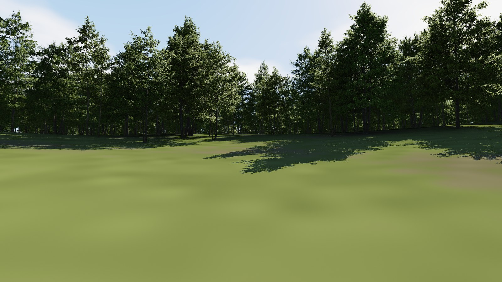
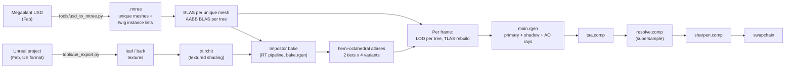
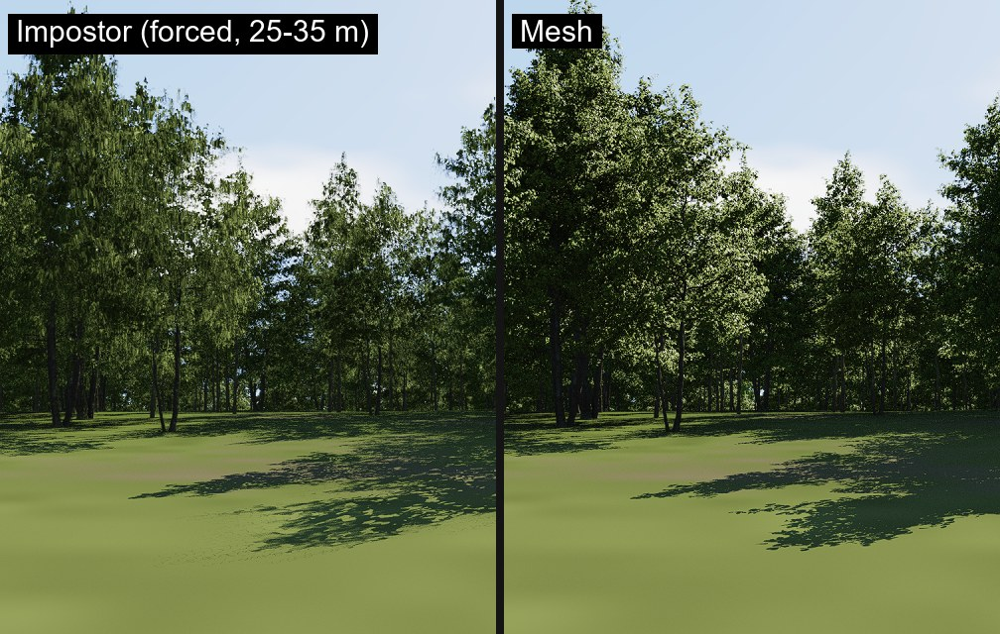
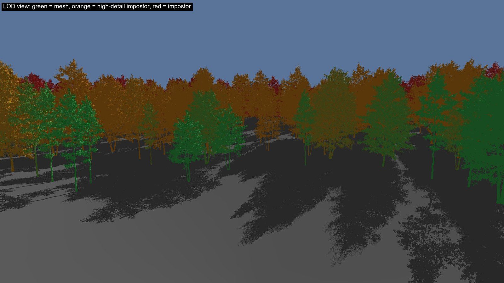

# SmartImposter

**A hardware ray-traced forest renderer, written from scratch in Rust + Vulkan, where every tree
beyond 50 m is a parallax octahedral impostor evaluated by the RTX cores.**

Nearby trees are the real thing: Quixel Megaplants with every leaf as geometry, 82–756 million
triangles per tree once all twig instances are expanded. Beyond that, each tree collapses to a
single AABB in the acceleration structure. When a ray reaches the box, an intersection shader
ray-marches a baked hemi-octahedral atlas of the tree (colour, normals, depth, coverage,
directional visibility). The bake itself is ray traced by the same GPU in about 1.5 s at startup.
Traversal, culling and shadows all stay inside the ray tracing pipeline.



|  |  |
|---|---|
| 81,303 trees. Everything past 50 m is an impostor. | Skimming the canopy at 1440p |

## Highlights

- **Hardware ray tracing end to end:** primary rays, sun shadows, AO and the impostor bake all go
  through `VK_KHR_ray_tracing_pipeline`. There's no rasterizer.
- **Impostors as procedural geometry:** one AABB per far tree. The RT cores do traversal and
  culling, and a custom intersection shader marches the baked depth (parallax occlusion mapping in
  each view's orthographic space).
- **A three-tier LOD chain with no popping:** real mesh < 50 m, high-detail impostor 50–100 m,
  standard impostor > 100 m. Each boundary is a stochastic per-pixel dissolve: the mesh any-hit
  and the impostor intersection shader share one random number, so exactly one copy of a tree
  answers each ray.
- **Impostors that light like the real tree:** traced, layered self-shadowing gives dappled light
  inside crowns and on the ground under them. The sunlit fraction matches the real leaves within
  1%, and overall brightness within about ±7%.
- **Real Megaplant materials:** leaf/bark colour, normal, translucency and AO textures exported
  from Unreal. Mip selection uses a ray cone, since RT shaders have no derivatives.
- **Image quality:** TAA with reprojection, disocclusion rejection and variance clipping;
  supersampling (1x/1.5x/2x) with a tonemap-before-average resolve; contrast-adaptive sharpening.
- **Fast:** 7.2 ms per frame for a 1080p flyover of 81k trees, versus 40.7 ms with every tree
  as real geometry (RTX 5080, 1x supersampling, camera moving).

## Performance

RTX 5080, camera moving every frame (no accumulation), TLAS rebuilt whenever trees change LOD.

| Scene | Frame time |
|---|---|
| 1080p flyover, 1x supersampling, full LOD chain + TAA + sharpening | 7.2 ms (140 fps) |
| same flyover, every tree as real geometry to 400 m (4.3M TLAS instances) | 40.7 ms (25 fps) |
| 1080p walking at eye height, 1x | 5.6 ms (179 fps) |
| 1440p flyover, 1x | 8.9 ms (113 fps) |
| 1440p flyover, 1.5x supersampling (the default) | 14.9 ms (67 fps) |

Startup (load, BLAS build, bake of 8 atlas slots) takes about 3–4 s. The atlases use 7.4 GB of
VRAM: 4 tree variants x 2 tiers x (albedo, normal/depth/coverage, visibility) x mips.

## How it works



### 1. Assets: keeping 756M triangles cheap

A Megaplant is a trunk mesh plus a point instancer that places 300–3,000 copies of three twig
meshes (200–290k triangles each, with leaves as real geometry). `usd_to_mtree.py` keeps that
structure: unique meshes plus a list of (mesh, transform) parts per tree. It also splits vertices
by UV, computes smooth normals, and tags each individual leaf (connected component) with a random
id for colour variation. The engine builds one BLAS per unique mesh. A near tree costs one TLAS
instance per twig, not a copy of its geometry.

### 2. Baking the impostor with ray tracing

`bake.rgen` builds a TLAS containing just one full-detail tree and shoots orthographic rays from
12x12 (standard) or 14x14 (high-detail) directions on a hemi-octahedral grid, with 3x3 sub-samples
per texel. It's the same ray tracing pipeline and the same textured closest-hit shader used at
runtime, so the bake sees exactly the materials the meshes have.


Per texel it stores:

| Atlas | Contents |
|---|---|
| RGBA8 | sqrt(albedo), ray-traced ambient occlusion |
| RGBA16F | octahedral normal, depth along the view, coverage (fraction of sub-samples that hit) |
| RGBA8 | directional self-visibility as a linear function `V(L) = a + b·L`, fitted from 12 rays per hit through the whole tree; used for sky occlusion |

Mips are generated with a coverage-weighted downsample, so empty texels don't drag depth or colour
towards zero.

### 3. The intersection shader (`shaders/impostor.rint`)

For each far tree a ray touches, the RT cores invoke the intersection shader with the ray in tree
space:

1. **LOD decision.** The shader looks up the instance's tree (per-instance buffer indexed by
   `gl_InstanceID`). It dissolves against the mesh copy if the tree is in the 50 m band, and picks
   the high-detail or standard atlas in the 100 m band.
2. **View selection.** It finds the 3 baked views around the ray direction and picks **one**,
   with probability equal to its (sharpened) barycentric weight. Blending three slightly
   misaligned views per sample causes ghosting and a smeared look; TAA averages the stochastic
   choice instead.
3. **Parallax march.** In that view's orthographic space the ray is linear, `S(t) = A + B·t`
   (uv, height), and is marched against the baked depth:
   - **Front crossings only:** a hit requires an empty → solid transition, so rays entering the
     box from the side don't hit extruded heightfield walls.
   - **Foliage shell:** a 1.2 m thick shell behind the surface, not an infinitely deep solid, so
     views from below don't smear on clump undersides.
   - **Coverage decided once per crossing:** a ray is blocked with probability equal to the
     texel's coverage. Testing at every step biases towards the maximum along the path, which
     made crowns too dense and shadows solid.
   - **Adaptive step count, binary refinement, single-mip march fetches.**
4. **Attributes.** It reports the hit with albedo, normal and visibility packed into hit
   attributes, and the tier in the hit kind.

### 4. Shadows and lighting that match the real tree

Shadow rays through an impostor are marched like a camera ray **from the sun**: stochastic view
choice around the light direction, shell crossing, then a fresh coverage test every 1.2 m of crown
depth (layered, Beer–Lambert-like). The light that reaches a leaf or the ground is dappled, and the
mean sunlit fraction matches the real geometry (56.9 vs 56.4 in `--debug 5`). Sky occlusion comes
from the baked visibility atlas. Calibration was done against the real meshes with
`tools/compare.ps1` and `tools/treestats.py`.




### 5. LOD chain and smooth transitions



| Distance | Representation | In the TLAS |
|---|---|---|
| < 50 m | real mesh | one instance per twig/trunk, `FORCE_OPAQUE` |
| 44–56 m | both | twigs non-opaque with a dissolve any-hit (`tri.rahit`), plus the impostor |
| 50–100 m | high-detail impostor (14x14 views x 576 px) | one AABB |
| > 100 m | standard impostor (12x12 views x 384 px) | one AABB (same instance, other atlas) |

The CPU keeps a per-tree state machine with hysteresis and rebuilds the TLAS only when a tree
changes state. The shaders compute the fade from the exact distance every frame, so the
transition is continuous.

### 6. Materials


`tri.rchit` shades leaves and bark with the Megaplant textures:
- **Leaves:** colour, normal map, and a translucency map that drives transmission with the Unreal
  material's translucency tint.
- **Bark:** colour, normal, and AO.
- **Normal mapping:** a tangent frame built per triangle from the UV gradients.
- **Mip selection:** a ray cone (hit distance x pixel spread vs texel size on the triangle).
- **Leaf variation:** a subtle per-leaf colour change from the converter's leaf ids, and paler
  undersides.
- **Highlights:** a GGX sheen on leaf tops. Impostor normals average many leaves, so they get a
  much broader, weaker lobe.

### 7. Frame

`main.rgen` traces the primary ray and computes direct sun light (traced shadow), leaf
transmission, specular, sky ambient with traced AO, and a procedural sky with clouds. It writes HDR
colour and hit distance. Then:
- **`taa.comp`:** reprojects each pixel into the previous camera and fetches history with a 4x4
  Catmull-Rom filter. It rejects history on depth mismatch, clips it to the YCoCg variance box,
  and blends with Karis weighting. When the camera is still it switches to an exact running
  average.
- **`resolve.comp`:** area-weighted downsample from the supersampled resolution, tonemapping each
  sample before averaging (ACES).
- **`sharpen.comp`:** contrast-adaptive sharpening.

## Getting started

### Requirements
- A GPU with Vulkan hardware ray tracing (`VK_KHR_ray_tracing_pipeline`, `VK_KHR_acceleration_structure`). Developed on an RTX 5080.
- ~10 GB of free VRAM at the default impostor resolutions. Lower them with `--imp-hi-res 0`
  (disables the high-detail tier) or `--imp-res 256`.
- Rust (stable) and the [Vulkan SDK](https://vulkan.lunarg.com/), for `glslangValidator`.
- Python 3.12 with `usd-core`, `numpy` and `pillow`, for the asset converter.

### Tree assets (not included)

The trees are **Quixel Megaplants** from [Fab](https://www.fab.com). Their license doesn't allow
redistribution, so this repository contains no assets. Get them yourself:

1. On Fab, add **Megaplants: Black Alder** (free) and download the **USD** format.
2. Convert it:
   ```
   python -m venv tools/.venv
   tools/.venv/Scripts/pip install usd-core numpy pillow
   tools/.venv/Scripts/python tools/usd_to_mtree.py assets/black_alder.mtree \
       Tree_Black_Alder_01_A.usd Tree_Black_Alder_01_B.usd Tree_Black_Alder_01_C.usd Tree_Black_Alder_01_D.usd
   ```
3. (Recommended) Textures: the USD carries only flat colours. Add the **Unreal Engine** format of
   the same Megaplant to a UE 5.x project (enable the Procedural Vegetation Editor plugin and
   Nanite Foliage), then export the textures headlessly:
   ```
   UnrealEditor-Cmd.exe <Project>.uproject -run=pythonscript -script=<repo>/tools/ue_export.py ^
       -EnablePlugins=PythonScriptPlugin,EditorScriptingUtilities -unattended -nullrhi
   ```
   This writes `assets/textures/*.png`. Without textures the engine falls back to procedural leaf
   colours.

### Build and run

```
cargo run --release
```

| Flag | Meaning |
|---|---|
| `--size 2560x1440`, `--fullscreen` | window size / borderless fullscreen |
| `--fly` | automatic showcase fly-through (1.8 km loop) |
| `--ss 2` | supersampling factor (default 1.5) |
| `--lod 50 --lod2 100` | mesh / high-detail impostor distances |
| `--lod-band 12 --lod2-band 24` | dissolve band widths |
| `--imp-res 384 --imp-grid 12`, `--imp-hi-res 576 --imp-hi-grid 14` | atlas sizes (`--imp-hi-res 0` disables the tier) |
| `--sharpen 0.5`, `--no-taa` | post-processing |
| `--shot out.png --frames N --cam x,y,z,yaw,pitch` | render N frames, save, exit |
| `--bench-move 0.25` | move every frame and print frame-time statistics |
| `--gallery` | the 4 tree variants in a row on flat ground |
| `--dump-atlas prefix` | write the baked atlases as PNGs |
| `--debug N` | 1 LOD view, 2 normals, 3 albedo, 4 AO, 5 sun visibility, 6/7 TAA history |

### Controls

| Input | Action |
|---|---|
| Left click / Esc | capture / release the mouse (Esc again quits) |
| Right mouse | look without capturing |
| W A S D, Q / E (Space) | fly, down / up. Shift 4x, Ctrl 0.25x |
| Mouse wheel | fly speed |
| C | cinematic smoothing |
| F | automatic fly-through on/off |
| `[` `]` / `;` `'` | mesh / high-detail impostor distance |
| 0–5 | debug views |
| K | supersampling 1x / 1.5x / 2x |
| T | TAA on/off |
| H | sharpening strength |
| Arrow keys | sun azimuth / elevation |
| `-` `=` | exposure |
| O | AO rays per pixel |
| P | print the camera as `--cam` |
| F11 / F12 | fullscreen / screenshot |

## Tools

| Script | Purpose |
|---|---|
| `tools/usd_to_mtree.py` | Megaplant USD → `.mtree` (instanced meshes, UVs, leaf ids) |
| `tools/ue_export.py` | run inside Unreal: export the Megaplant textures and material parameters |
| `tools/compare.ps1`, `tools/treestats.py` | render the same view as impostors and as meshes in several debug modes and compare tree-pixel statistics |
| `tools/sweep.ps1`, `tools/sweep_plot.py` | tree brightness vs camera distance, smooth vs hard LOD switching |
| `tools/usd_inspect.py`, `tools/usd_details.py`, `tools/uv_check.py`, `tools/leaf_check.py` | asset inspection |
| `tools/make_docs_images.py` | build the README images from renders |

## Code layout

```
src/
  main.rs      window, input, fly-cam, showcase path wiring, CLI
  renderer.rs  pipelines, SBT, impostor bake, LOD state machine, TLAS, TAA/resolve/sharpen passes
  gpu.rs       Vulkan device (RT extensions), buffers, images, swapchain
  accel.rs     BLAS / TLAS building, instance records
  asset.rs     .mtree loader
  textures.rs  PNG decode + GPU mip generation
  world.rs     procedural terrain and forest scatter
  flypath.rs   arc-length parameterised Catmull-Rom showcase path
shaders/
  main.rgen  bake.rgen  tri.rchit  tri.rahit  impostor.rint  impostor.rchit  miss.rmiss  shadow.rmiss
  taa.comp  resolve.comp  sharpen.comp  mip.comp  (+ rt.glsl, globals.glsl, shared.glsl)
```

## Limitations

- **Close upward views of impostors:** atlases cover only the upper hemisphere. Impostors seen
  from directly below at close range (forced below 50 m) still show some vertical streaking. At
  the default LOD those trees are meshes.
- **No wind:** the Megaplant DynamicWind data is ignored.
- **One species:** the forest uses the 4 Black Alder variants. The pipeline supports more
  `.mtree` packs (up to 16 atlas slots).
- **Grainy LOD bands while moving:** the dissolve bands and 1-sample shadows/AO rely on TAA, so
  they're slightly grainy in fast motion.
- **No leaf alpha:** the leaf-texture alpha (cut-out) channel isn't used. Leaf outlines come from
  the geometry.

## License

The code in this repository is released under the [MIT License](LICENSE).

The Quixel Megaplants assets and textures are **not** part of this repository and remain subject
to their own Fab license. The screenshots show them rendered by this engine.
