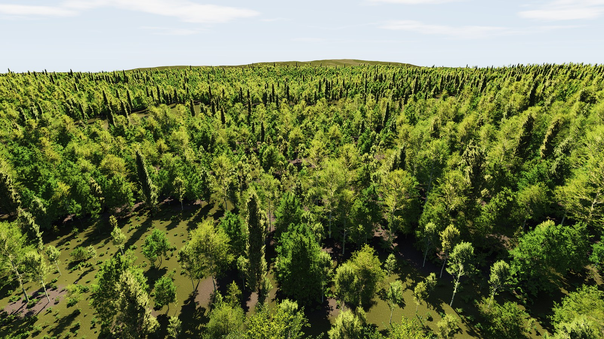
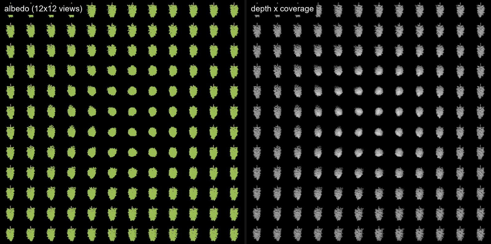
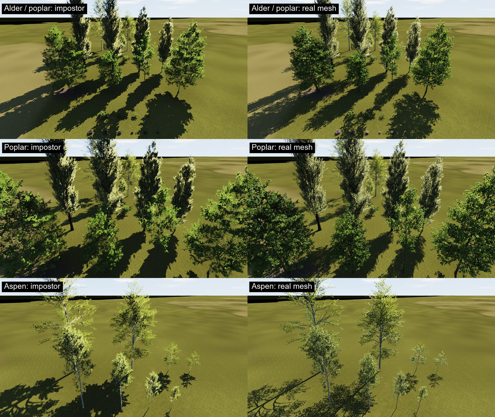
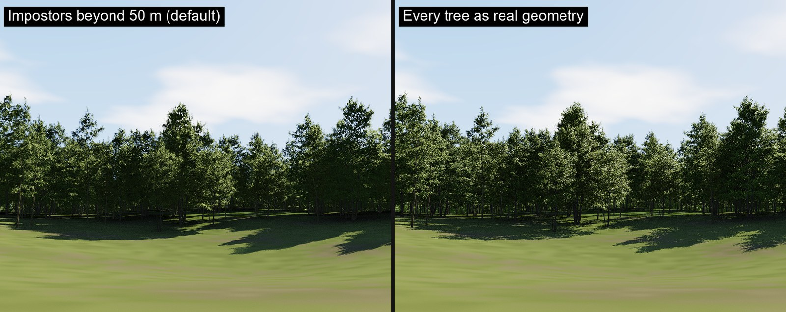

# SmartImposter

**A hardware ray-traced forest renderer, written from scratch in Rust + Vulkan, where every plant
beyond its mesh distance is a parallax octahedral impostor evaluated by the RTX cores.**

The forest mixes 8 Quixel Megaplant species (34 variants): beech, black alder, black poplar,
aspen, hazel, heather, huckleberry and bracken. That's about 340,000 plants: 103k trees, 57k
shrubs and 183k ferns, placed by biome. Nearby plants are the real thing, with every leaf as
geometry: up to 519 million triangles per tree once all twig instances are expanded. Beyond that,
each plant collapses to a single AABB in the acceleration structure. When a ray reaches the box, an
intersection shader ray-marches a baked hemi-octahedral atlas of the plant (colour, normals, depth,
coverage, directional visibility). The bake is ray traced by the same GPU in about 2 s at startup
and then block-compressed on the GPU. Traversal, culling and shadows all stay inside the ray
tracing pipeline.


|  |  |
|---|---|
| Mixed forest from 55 m up. Everything past the mesh distance is an impostor. | Beech, aspen and alder over leaf litter |
|  | |
| Heather in an open meadow on scanned grass | |

## Highlights

- **Hardware ray tracing end to end:** primary rays, sun shadows, AO and the impostor bake all go
  through `VK_KHR_ray_tracing_pipeline`. There's no rasterizer.
- **Impostors as procedural geometry:** one AABB per far plant. The RT cores do traversal and
  culling, and a custom intersection shader marches the baked depth (parallax occlusion mapping in
  each view's orthographic space).
- **A mixed forest from data:** every species pack in `assets/species` is loaded, and three
  scattered layers (canopy, shrubs, ferns) follow biome fields: beech stands, alder on wet low
  ground, poplar and hazel at forest edges, aspen groves, heather in dry open ground, bracken under
  the canopy.
- **Compressed, size-aware atlases:** each variant gets an atlas sized to the plant and
  BC-compressed on the GPU right after the bake. All 34 variants take 1.83 GB instead of 11.4 GB
  uncompressed.
- **LOD with no popping:** each boundary is a stochastic per-pixel dissolve. The mesh any-hit and
  the impostor intersection shader share one random number, so exactly one copy of a plant
  answers each ray. LOD distances scale with plant size, and small plants dissolve out at their
  draw distance.
- **Impostors that light like the real plant:** traced, layered self-shadowing gives dappled light
  inside crowns and on the ground under them. Leaf transmission and the glossy leaf sheen are
  modelled for a crown of leaves, not a surface, and calibrated per species against the real
  meshes.
- **Real materials:** Megaplant leaf/bark colour, normal, translucency and AO textures exported
  from Unreal, plus four scanned ground surfaces blended by a biome mask. Mip selection uses a ray
  cone, since RT shaders have no derivatives.
- **Image quality:** TAA with reprojection, disocclusion rejection and variance clipping;
  supersampling (1x/1.5x/2x) with a tonemap-before-average resolve; contrast-adaptive sharpening.

## Performance

RTX 5080, camera moving every frame (no accumulation), TLAS rebuilt whenever plants change LOD.
Full mixed forest (about 340k plants).

| Scene | Frame time |
|---|---|
| 1080p flyover, 1x supersampling, LOD + TAA + sharpening | 6.5 ms (155 fps) |
| same flyover, every plant as real geometry to 400 m (4.6M TLAS instances) | 42.5 ms (24 fps) |
| 1080p walking at eye height, 1x | 6.5 ms (155 fps) |
| 1440p flyover, 1x | 8.3 ms (120 fps) |
| 1440p flyover, 1.5x supersampling (the default) | 13.5 ms (74 fps) |

Startup (load and decode textures, BLAS build, bake and compress 34 atlases) takes about 4 s.
GPU memory: impostor atlases 1.83 GB, plant textures 0.58 GB, ground textures 0.27 GB.

## How it works

```mermaid
flowchart LR
    UE["Unreal project<br/>(Fab Megaplants)"] -->|tools/ue_export_megaplants.py| USD["per-species USD meshes,<br/>assembly.json, textures"]
    USD -->|tools/megaplant_to_mtree.py| MTREE["assets/species/*.mtree + .json<br/>unique meshes + part lists"]
    MTREE --> CAT["catalog.rs<br/>species, variants, LOD scale"]
    CAT --> WORLD["world.rs<br/>biome scatter, ground mask"]
    CAT --> BLAS["BLAS per unique mesh<br/>AABB BLAS per variant"]
    BLAS --> BAKE["Impostor bake<br/>(RT pipeline, bake.rgen)"]
    BAKE --> ENC["mip.comp + bcenc.comp<br/>BC3 / BC5 atlases"]
    WORLD --> FRAME["Per frame:<br/>LOD per plant, TLAS rebuild"]
    ENC --> FRAME
    FRAME --> TRACE["main.rgen<br/>primary + shadow + AO rays"]
    TRACE --> TAA["taa.comp"] --> RES["resolve.comp<br/>(supersample)"] --> CAS["sharpen.comp"] --> OUT["swapchain"]
```



### 1. Assets: keeping half a billion triangles cheap

In UE 5.x a Megaplant is a Nanite assembly: a hierarchy of parts (trunk, branches, twigs, leaf
clusters) placed by transforms, with the same few meshes reused hundreds to thousands of times.
`ue_export_megaplants.py` reads that assembly data inside Unreal and exports each unique mesh, the
part hierarchy, the textures and the material parameters. `megaplant_to_mtree.py` flattens the
hierarchy: small subtrees are merged into one mesh, large ones stay instanced. The result is unique
meshes plus a list of (mesh, transform) parts per variant. The engine builds one BLAS per unique
mesh (129 meshes, 9.1M triangles), so a near tree costs one TLAS instance per part, not a copy of
its geometry.

### 2. Baking and compressing the impostor

`bake.rgen` builds a TLAS containing just one full-detail plant and shoots orthographic rays from
12x12 directions on a hemi-octahedral grid, with 3x3 sub-samples per texel. It's the same ray
tracing pipeline and the same textured closest-hit shader used at runtime, so the bake sees exactly
the materials the meshes have.



Each variant's frame resolution follows its size: 5.5 cm texels for a full-size tree (scaled by the
variant's LOD scale, since small plants switch to impostors closer), rounded to a multiple of 32
and capped at 448 px. Heather gets 96 px frames, a 26 m beech 448 px.

The bake writes an uncompressed scratch atlas shared by all variants. `mip.comp` builds
coverage-weighted mips, so empty texels don't drag depth or colour towards zero. Then
`bcenc.comp` (one thread per 4x4 block) compresses every level, and the blocks are copied into the
sampled atlases:

| Atlas | Format | Contents |
|---|---|---|
| albedo | BC3 | sqrt(albedo), ray-traced ambient occlusion |
| normal | BC5 | octahedral normal |
| depth | BC5 | depth along the view, coverage (fraction of sub-samples that hit) |
| visibility | BC3, half resolution | directional self-visibility `V(L) = a + b·L`, fitted from 12 rays per hit; used for sky occlusion |

Texels with zero coverage are left out of the block endpoint fit, so silhouette blocks keep their
precision. That's 3.25 bytes per texel instead of 16. With the size-based resolution, all 34
variants take 1.83 GB (6–125 MB each).

### 3. The intersection shader (`shaders/impostor.rint`)

For each far plant a ray touches, the RT cores invoke the intersection shader with the ray in
plant space:

1. **LOD decision.** The shader looks up the instance (per-instance buffer indexed by
   `gl_InstanceID`). It dissolves against the mesh copy if the plant is in the mesh band, and
   dissolves the plant out near its draw distance.
2. **View selection.** It finds the 3 baked views around the ray direction and picks **one**,
   with probability equal to its (sharpened) barycentric weight. Blending three slightly
   misaligned views per sample causes ghosting and a smeared look; TAA averages the stochastic
   choice instead.
3. **Parallax march.** In that view's orthographic space the ray is linear, `S(t) = A + B·t`
   (uv, height), and is marched against the baked depth:
   - **Front crossings only:** a hit requires an empty → solid transition, so rays entering the
     box from the side don't hit extruded heightfield walls.
   - **Foliage shell:** a thin shell behind the surface (0.12 of the radius), not an infinitely
     deep solid, so views from below don't smear on clump undersides.
   - **Coverage decided once per crossing:** a ray is blocked with probability equal to the
     texel's coverage. Testing at every step biases towards the maximum along the path, which
     made crowns too dense and shadows solid.
   - **Adaptive step count, binary refinement, single-mip march fetches.**
4. **Attributes.** It reports the hit with albedo, normal and visibility packed into hit
   attributes.

### 4. Shadows and lighting that match the real plant

Shadow rays through an impostor are marched like a camera ray **from the sun**: stochastic view
choice around the light direction, shell crossing, then a fresh coverage test every 0.12 of the
radius of crown depth (layered, Beer–Lambert-like). The light that reaches a leaf or the ground is
dappled, and the mean sunlit fraction matches the real geometry. Sky occlusion comes from the baked
visibility atlas.

An impostor's normal belongs to the crown, not to a leaf, so two terms are modelled for a crown of
leaves:
- **Transmission:** a real leaf transmits by its own orientation, so back light spreads over many
  leaves at moderate strength. With the crown normal, `max(-n·l)` put the whole crown's
  transmission on the side facing away from the sun at full strength, and the tonemapper bleached
  those hot spots to yellow-white. Impostors use a broad lobe with the same total energy and half
  the peak.
- **Leaf sheen:** in a crown of glossy leaves some leaf always faces the half vector, so the sun's
  reflection is a Fresnel sheen of the view/sun geometry, not a lobe on the crown normal.

Both are calibrated per species against the real meshes with the debug views (8 transmission,
9 sheen): sheen within 0.93–1.09x and lit colour within 0.96–1.11x per channel, backlit and
front-lit.






### 5. LOD and draw distance

| Distance (x the variant's LOD scale) | Representation | In the TLAS |
|---|---|---|
| < 44 m | real mesh | one instance per part, `FORCE_OPAQUE` |
| 44–56 m | both | parts non-opaque with a dissolve any-hit (`tri.rahit`), plus the impostor |
| > 56 m | impostor | one AABB |
| 0.8–1x draw distance | impostor dissolving out | small plants only |

The LOD scale is the plant's height / 16 m, clamped to 0.25–1.2. A 32 m poplar switches at 60 m,
a fern at 12.5 m. Plants under 2 m are drawn to 120 + 60 m per metre of height, plants under 6 m
to 450 m. The CPU keeps a per-plant state machine with hysteresis and rebuilds the TLAS only when
a plant changes state; the shaders compute the fade from the exact distance every frame, so the
transition is continuous. An 8M-instance budget keeps very long mesh distances from exhausting GPU
memory.

### 6. Forest layout and ground

`world.rs` scatters three jittered-grid layers: canopy trees every 7 m, shrubs every 3.4 m and
ferns every 2.1 m, the last two within 900 m. Each layer reads biome fields: canopy density,
moisture (low ground and wet patches), forest edges, beech stands and aspen groves. Variants are
picked by weight, and each plant gets its own scale and rotation.

The ground blends four scanned surfaces (forest floor, mossy grass, uncut grass, dried grass)
found in the Fab library cache. A 1024² mask is built at startup from the actual tree crowns
(canopy cover), moisture, dryness and understory density. Leaf litter goes under closed canopy,
moss on wet ground and under scattered trees, and grass in the open. The shader uses height-based
blending, a second rotated sample against tiling, and a per-layer gain: the scans' mean albedos
differ about 10x.

### 7. Materials


`tri.rchit` shades leaves and bark with each species' Megaplant textures (4 per species, selected
by the mesh's texture set):
- **Leaves:** colour, normal map, and a translucency map. Transmitted light is leaf albedo x the
  Unreal material's translucency tint x the translucency mask, like Unreal's two-sided foliage.
- **Per-species normalisation:** Megaplant colour maps are authored very differently (Unreal's
  material darkens the pale ones), so the foliage brightness and the translucency mask are
  normalised per species from texture statistics at load time.
- **Bark:** colour, normal, and AO.
- **Normal mapping:** a tangent frame built per triangle from the UV gradients.
- **Mip selection:** a ray cone (hit distance x pixel spread vs texel size on the triangle).
- **Leaf variation:** a subtle per-leaf colour change from the converter's leaf ids, and paler
  undersides.

### 8. Frame

`main.rgen` traces the primary ray and computes direct sun light (traced shadow), leaf
transmission, specular, sky ambient with traced AO, and a procedural sky with clouds. It writes HDR
colour and hit distance. Then:
- **`taa.comp`:** reprojects each pixel into the previous camera and fetches history with a 4x4
  Catmull-Rom filter. It rejects history on depth mismatch, clips it to the YCoCg variance box,
  and blends with Karis weighting. When the camera is still it switches to an exact running
  average.
- **`resolve.comp`:** area-weighted downsample from the supersampled resolution, tonemapping each
  sample before averaging (ACES).
- **`sharpen.comp`:** contrast-adaptive sharpening.

## Getting started

### Requirements
- A GPU with Vulkan hardware ray tracing (`VK_KHR_ray_tracing_pipeline`, `VK_KHR_acceleration_structure`). Developed on an RTX 5080 (16 GB).
- About 4 GB of free VRAM for atlases and textures at the defaults. Lower it with
  `--imp-res 320`, `--imp-texel 0.08`, `SI_TEX_MAX=1024` or `--species Beech,Alder`.
- Rust (stable) and the [Vulkan SDK](https://vulkan.lunarg.com/), for `glslangValidator`.
- Python 3.12 with `usd-core`, `numpy` and `pillow`, for the asset converter.

### Plant assets (not included)

The plants are **Quixel Megaplants** from [Fab](https://www.fab.com). Their license doesn't allow
redistribution, so this repository contains no assets. Get them yourself:

1. On Fab, add the Megaplants you want (for example Black Alder, Black Poplar, European Beech,
   European Aspen, Common Hazel, Common Heather, Huckleberry Oak, Bracken Fern) and add the
   **Unreal Engine** format to a UE 5.x project. Enable the Procedural Vegetation Editor plugin and
   Nanite Foliage. They land in `/Game/Megaplant_Library`.
2. Export meshes, assembly data, textures and material parameters headlessly:
   ```
   UnrealEditor-Cmd.exe <Project>.uproject -run=pythonscript -script=<repo>/tools/ue_export_megaplants.py ^
       -EnablePlugins=PythonScriptPlugin,EditorScriptingUtilities,USDImporter -unattended -nop4 -nosplash -NullRHI
   ```
   This writes `assets/megaplants/<Species>/`. `SI_ONLY=Beech` limits it to matching species.
3. Convert each species:
   ```
   python -m venv tools/.venv
   tools/.venv/Scripts/pip install usd-core numpy pillow
   tools/.venv/Scripts/python tools/megaplant_to_mtree.py assets/megaplants/Tree_European_Beech assets/species/Tree_European_Beech
   ```
   This writes `assets/species/<Species>.mtree` and `.json` (kind, textures, Unreal tints,
   variants, heights). The engine loads every pack in `assets/species`. Species it doesn't know
   by name are spread evenly through the matching layer.
4. (Optional) Ground: add the Fab surfaces **Forest Floor**, **Mossy Grass**, **Uncut Grass** and
   **Grass Dried** (glTF, 2K) to your Fab library. The engine finds them in the Fab library cache
   (`D:/EpicVault/VaultCache/FabLibrary` by default; set `SI_GROUND_DIR`). Without them the
   terrain is procedural.

The older single-species route (USD download → `tools/usd_to_mtree.py`, textures via
`tools/ue_export.py`) still works: with no `assets/species` packs the engine loads
`assets/black_alder.mtree` and `assets/textures`.

### Build and run

```
cargo run --release
```

| Flag | Meaning |
|---|---|
| `--size 2560x1440`, `--fullscreen` | window size / borderless fullscreen |
| `--fly` | automatic showcase fly-through (1.8 km loop) |
| `--ss 2` | supersampling factor (default 1.5) |
| `--lod 50`, `--lod-band 12` | mesh distance for a 16 m plant and dissolve band width |
| `--species Beech,Fern` | load only matching species packs |
| `--imp-texel 0.055 --imp-res 448 --imp-grid 12` | impostor texel size (m), maximum frame resolution, views per side |
| `--spacing 7 --radius 1400` | canopy tree spacing and forest radius |
| `--sharpen 0.5`, `--no-taa` | post-processing |
| `--shot out.png --frames N --cam x,y,z,yaw,pitch` | render N frames, save, exit |
| `--views "x,h,z,yaw,pitch[,lod,debug];..."` | several cameras in one run (h above ground), one screenshot each |
| `--bench-move 0.25` | move every frame and print frame-time statistics |
| `--gallery` | every variant on flat ground, one row per species |
| `--dump-atlas prefix` | write the first variant's uncompressed albedo atlas as a PNG |
| `--debug N` | 1 LOD view, 2 normals, 3 albedo, 4 AO, 5 sun visibility, 6/7 TAA history, 8 leaf transmission, 9 sheen (x16), 10 diffuse |

| Environment | Meaning |
|---|---|
| `SI_TEX_MAX` | maximum plant/ground texture size (default 2048) |
| `SI_GROUND_DIR` | Fab library cache with the ground surfaces |
| `SI_FOREST_MAP` | print a coarse plant-count map |

### Controls

| Input | Action |
|---|---|
| Left click / Esc | capture / release the mouse (Esc again quits) |
| Right mouse | look without capturing |
| W A S D, Q / E (Space) | fly, down / up. Shift 4x, Ctrl 0.25x |
| Mouse wheel | fly speed |
| C | cinematic smoothing |
| F | automatic fly-through on/off |
| `[` `]` | mesh distance |
| 0–5 | debug views |
| K | supersampling 1x / 1.5x / 2x |
| T | TAA on/off |
| H | sharpening strength |
| Arrow keys | sun azimuth / elevation |
| `-` `=` | exposure |
| O | AO rays per pixel |
| P | print the camera as `--cam` |
| F11 / F12 | fullscreen / screenshot |

## Tools

| Script | Purpose |
|---|---|
| `tools/ue_export_megaplants.py` | run inside Unreal: export every Megaplant's meshes, Nanite assembly hierarchy, textures and material parameters |
| `tools/megaplant_to_mtree.py` | flatten an exported Megaplant into `.mtree` + species `.json` |
| `tools/usd_to_mtree.py`, `tools/ue_export.py` | single-species route from a Fab USD download |
| `tools/compare.ps1`, `tools/treestats.py` | render the same view as impostors and as meshes in several debug modes and compare tree-pixel statistics |
| `tools/sweep.ps1`, `tools/sweep_plot.py` | tree brightness vs camera distance, smooth vs hard LOD switching |
| `tools/usd_inspect.py`, `tools/usd_details.py`, `tools/uv_check.py`, `tools/leaf_check.py` | asset inspection |
| `tools/make_docs_images.py` | build the README images from renders |

## Code layout

```
src/
  main.rs      window, input, fly-cam, multi-view capture, CLI
  renderer.rs  pipelines, SBT, impostor bake + BC compression, LOD state machine, TLAS, TAA/resolve/sharpen passes
  catalog.rs   species packs, per-variant LOD scale and draw distance, ground surfaces
  gpu.rs       Vulkan device (RT extensions), buffers, images, swapchain
  accel.rs     BLAS / TLAS building, instance records
  asset.rs     .mtree loader
  textures.rs  parallel PNG decode, per-species normalisation, GPU mip generation
  world.rs     procedural terrain, biome scatter, ground mask
  flypath.rs   arc-length parameterised Catmull-Rom showcase path
shaders/
  main.rgen  bake.rgen  tri.rchit  tri.rahit  impostor.rint  impostor.rchit  miss.rmiss  shadow.rmiss
  taa.comp  resolve.comp  sharpen.comp  mip.comp  bcenc.comp  (+ rt.glsl, globals.glsl, shared.glsl)
```

## Limitations

- **Close upward views of impostors:** atlases cover only the upper hemisphere. Impostors seen
  from directly below at close range (forced below their mesh distance) still show some vertical
  streaking. At the default LOD those plants are meshes.
- **No wind:** the Megaplant DynamicWind data is ignored.
- **No grass blades:** the ground is textured, not covered with grass geometry.
- **Grainy LOD bands while moving:** the dissolve bands and 1-sample shadows/AO rely on TAA, so
  they're slightly grainy in fast motion.
- **No leaf alpha:** the leaf-texture alpha (cut-out) channel isn't used. Leaf outlines come from
  the geometry.
- **Instance budget order:** past the 8M-instance budget, plants are demoted to impostors in
  scatter order, not nearest first. Only very long mesh distances reach it.

## License

The code in this repository is released under the [MIT License](LICENSE).

The Quixel Megaplants and Megascans surfaces are **not** part of this repository and remain
subject to their own Fab license. The screenshots show them rendered by this engine.
